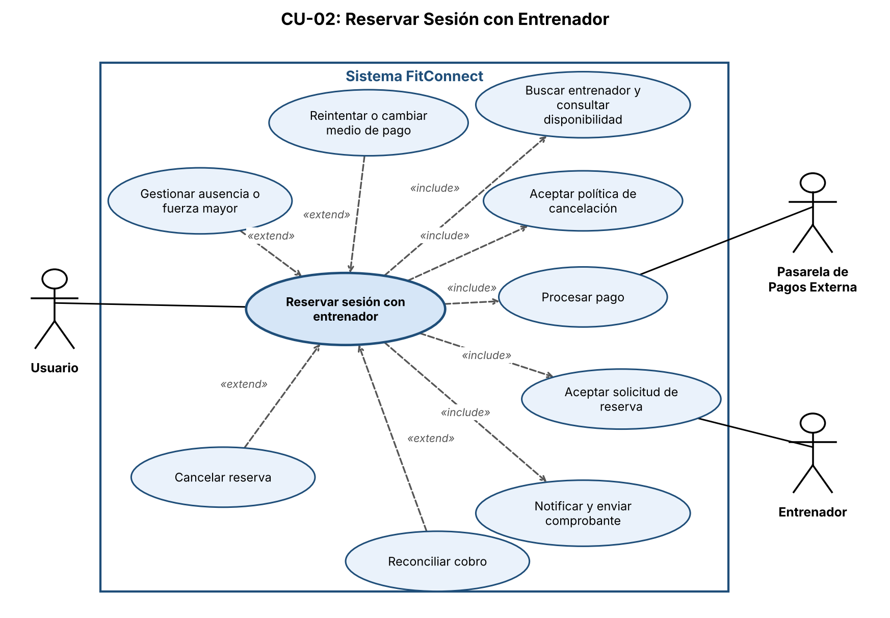
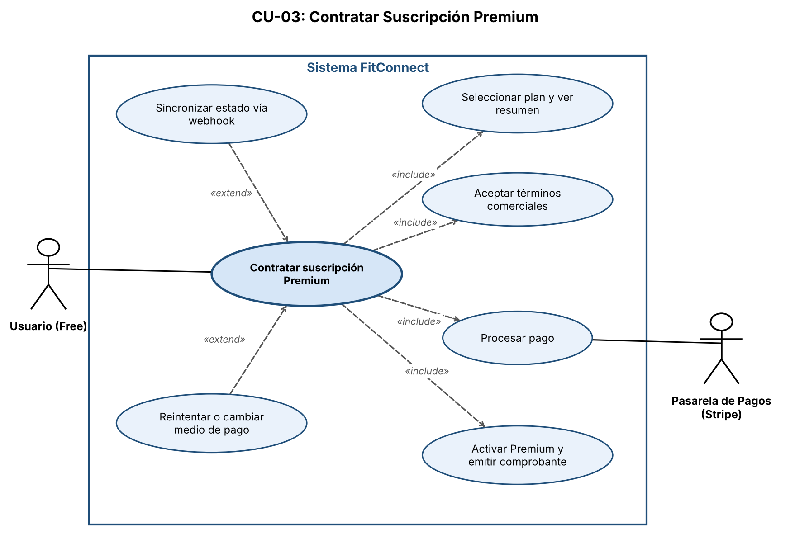
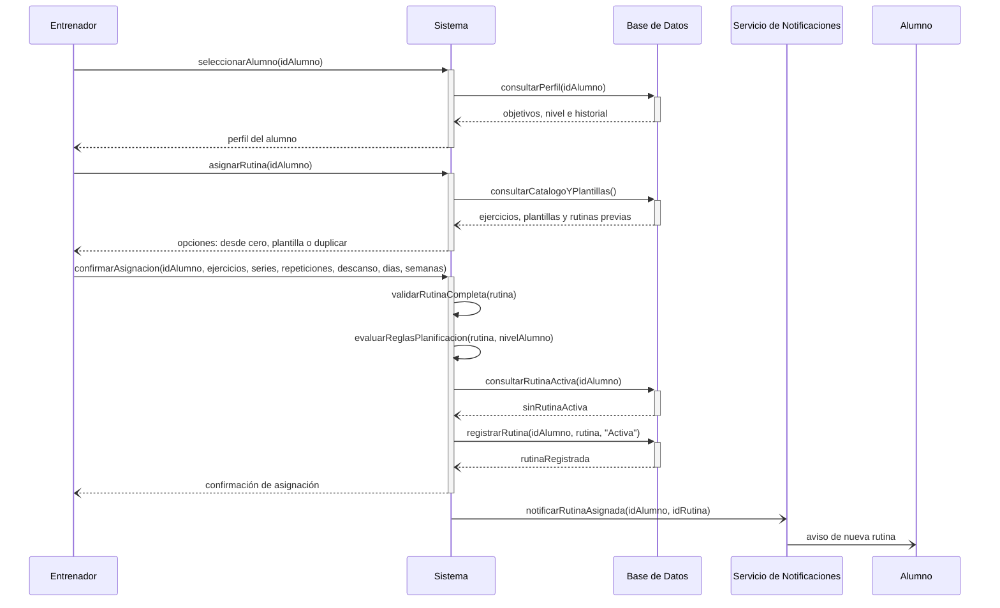
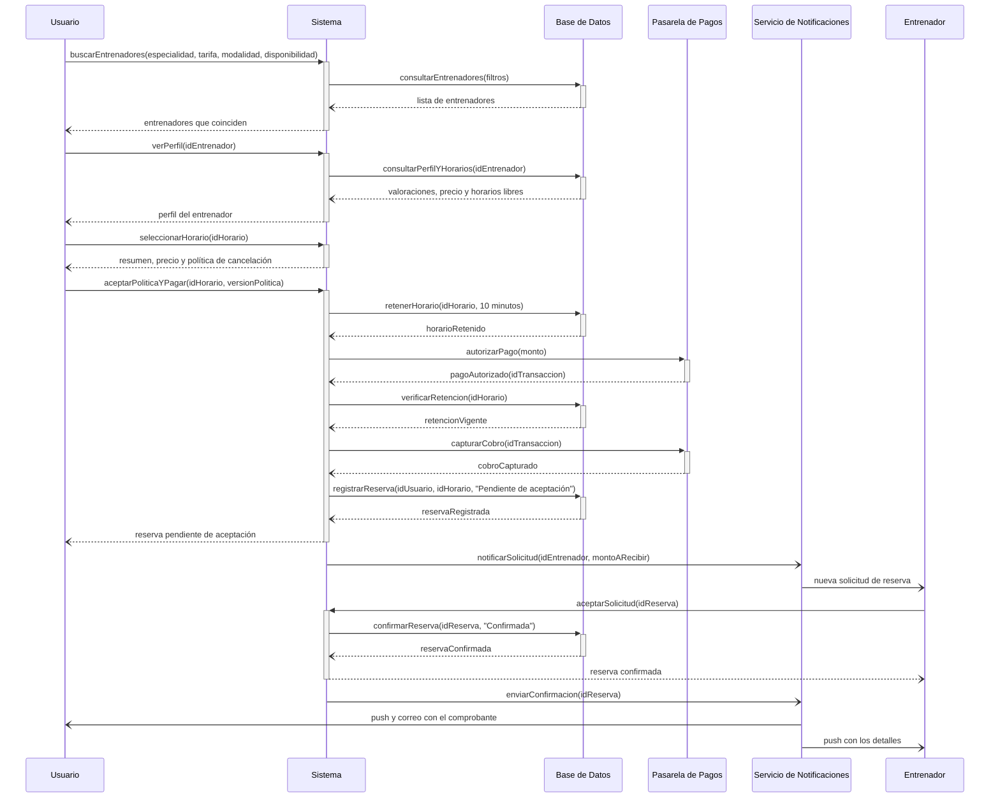
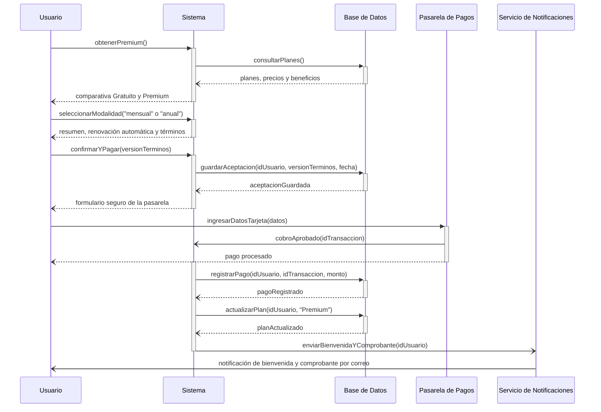
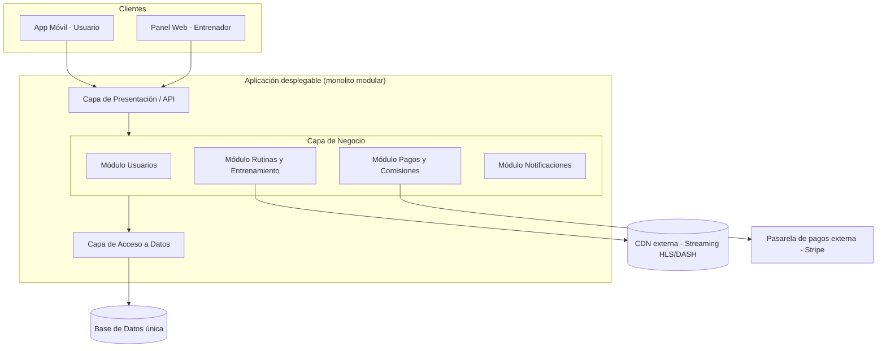
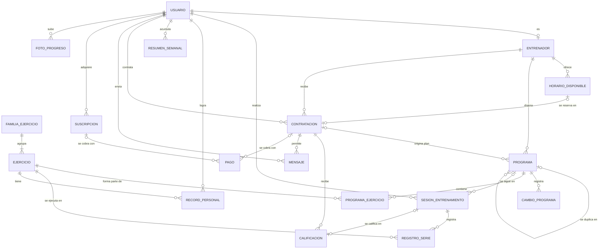

# FitConnect: Trabajo Práctico, Segunda Etapa

Prácticas Profesionalizantes 1, prof. Jorge Capoduri.

**Integrantes:** Agustín Curvetto, Santiago Menghi, Bautista Suero y Tomás Rodil.

FitConnect es una plataforma móvil que conecta entrenadores personales especializados en calistenia con personas que quieren entrenar sin equipamiento. Este documento reúne los siete puntos de la Segunda Etapa del trabajo práctico.

## Índice

1. [Técnicas de Recolección de Requisitos (Unidad 4)](#1-técnicas-de-recolección-de-requisitos-unidad-4)
2. [Identificación de Requisitos (Unidad 4)](#2-identificación-de-requisitos-unidad-4)
3. [Casos de Uso (Unidad 5)](#3-casos-de-uso-unidad-5)
4. [Diagramas de Interacción (Unidad 5)](#4-diagramas-de-interacción-unidad-5)
5. [Arquitectura de Software (Unidad 6)](#5-arquitectura-de-software-unidad-6)
6. [Modelado de Base de Datos (Unidad 6)](#6-modelado-de-base-de-datos-unidad-6)
7. [Atributos de Calidad (Unidad 3)](#7-atributos-de-calidad-unidad-3)

---

## 1. Técnicas de Recolección de Requisitos (Unidad 4)

Para FitConnect elegimos dos técnicas de elicitación complementarias: una cualitativa y profunda (**Entrevistas**) y otra cuantitativa y masiva (**Encuestas / Cuestionarios**). La combinación permite validar en profundidad las necesidades de los perfiles clave (entrenadores, usuarios activos) y, al mismo tiempo, confirmar con números si esas necesidades se repiten en el resto del mercado objetivo.

---

### Técnica 1: Entrevistas

**Descripción del proceso: ¿Cómo se aplicaría en FitConnect?**

Se realizarían entrevistas semiestructuradas individuales a los distintos perfiles de stakeholders identificados en la Primera Etapa:

- **Ana (Head de Entrenadores)** y 2-3 entrenadores externos, para entender cómo arman rutinas hoy (Excel, WhatsApp) y qué necesitan de un panel de control.
- **Enzo (usuario activo)** y 3-4 usuarios nuevos, para relevar el miedo a lesionarse, la falta de motivación y qué esperan del onboarding.
- **Gabriel (Product Manager)** y **Diego (CTO)**, para confirmar restricciones de negocio (conversión, churn) y técnicas (APK < 200MB, uptime 99,5%).

Cada entrevista se guía con una lista de preguntas abiertas ("Contame cómo armás hoy la rutina de un alumno a distancia"), dejando lugar a repreguntas según lo que surja. Se graban (con consentimiento) y se transcriben para extraer requisitos candidatos.

**¿Qué información permitiría obtener?**

- Motivaciones y frustraciones reales de entrenadores y usuarios, con ejemplos concretos.
- Detalles del flujo actual de trabajo (cómo siguen el progreso de un alumno, cómo cobran, cómo entrenan solos) que no aparecen en un documento de enunciado.
- Prioridades y matices que permiten refinar los criterios de aceptación de las historias de usuario.

**Dificultad**

Los entrenadores tienen agendas muy ajustadas (dan clases, atienden alumnos) y coordinar horarios para la entrevista es difícil; además, al ser una técnica 1 a 1, la cantidad de personas que se puede entrevistar es limitada y el resultado puede sesgarse hacia la opinión de quienes sí tuvieron tiempo de participar (sesgo de disponibilidad).

---

### Técnica 2: Encuestas / Cuestionarios

**Descripción del proceso: ¿Cómo se aplicaría en FitConnect?**

Se diseñaría un cuestionario online (Google Forms o Typeform) de 10-15 preguntas cerradas (escala Likert, opción múltiple) más 1-2 abiertas, distribuido a:

- Usuarios de la comunidad de calistenia y redes sociales de fitness, para medir cuánta gente sufre el problema de "no tener plata/tiempo para el gimnasio".
- Entrenadores freelance, para cuantificar cuántos usan hoy herramientas informales (Excel/WhatsApp) y cuánto pagarían/qué comisión aceptarían.

Preguntas ejemplo: "¿Cuántas veces abandonaste una rutina de entrenamiento por miedo a lastimarte?", "¿Pagarías una suscripción premium si incluye seguimiento de un entrenador real?".

**¿Qué información permitiría obtener?**

- Datos cuantitativos (porcentajes, promedios) que permiten priorizar problemas por volumen de gente afectada, validando el orden de impacto definido en la Primera Etapa (captar → retener → organizar).
- Segmentación de usuarios (principiantes vs. avanzados) útil para definir criterios de aceptación de las historias de usuario relacionadas con onboarding y progresión.

**Dificultad**

Las respuestas cerradas no permiten indagar el "por qué" detrás de una opinión, y suele haber una tasa de respuesta baja o sesgada (solo contestan quienes ya están interesados en fitness/apps), lo que puede dar una imagen poco representativa del usuario promedio que FitConnect quiere captar.

---

### Validación cruzada con el alcance del MVP (Primera Etapa, Punto 3)

Las entrevistas no solo relevan necesidades nuevas: también sirven para **confirmar o refutar con los propios stakeholders** el alcance del MVP definido en el análisis de stakeholders de la Primera Etapa (Punto 3). Por eso, dentro de la guía de preguntas de cada entrevista se incluye una pregunta puntual atada a cada criterio:

| Criterio del MVP (Primera Etapa) | Stakeholder a validar | Pregunta de entrevista que lo valida |
|---|---|---|
| **Interfaz:** registro e inicio de la primera actividad en máximo 3 toques | Gabriel (PM) y usuarios nuevos | "Si tuvieras que registrarte y arrancar a entrenar en menos de 3 toques, ¿qué información estarías dispuesto a saltear o completar después?" |
| **Panel mínimo del entrenador en el Sprint 1:** plantillas, duplicación, armado arrastrando ejercicios, asignación y progreso básico | Ana y entrenadores externos | "De las herramientas del panel, ¿cuáles necesitás desde el primer día para no seguir trabajando con Excel y WhatsApp?" |
| **Comisión:** 20 % fija y visible por transacción | Ana y entrenadores externos | "¿Una comisión fija del 20 % por transacción te resulta clara? ¿Qué información necesitás ver para saber cuánto ganás por sesión?" |
| **Rendimiento:** instalador de menos de 200 MB y arranque en menos de 3 s | Diego (CTO) | "¿Qué contenido creés que NO puede vivir localmente en el dispositivo sin romper el límite de 200 MB, y cómo lo resolverías con streaming?" |
| **Seguridad:** consentimientos explícitos y separados para datos de salud y para cada foto de progreso | Mara (Legal) | "¿Qué tipo de consentimiento necesitamos pedirle al usuario antes de guardar una foto de progreso, y qué pasa si no lo da?" |

**¿Por qué es importante esta validación?** Porque asegura que el alcance del MVP no quede como una definición unilateral del equipo, sino que esté **corroborado por la fuente original** (el propio stakeholder que puso esa restricción), cerrando el círculo entre lo que se definió en la Primera Etapa y lo que efectivamente se releva en las entrevistas.

---

## 2. Identificación de Requisitos (Unidad 4)

### a) Requisitos Funcionales (Historias de Usuario)

#### RF-01: Registro e inicio de sesión

**Como** usuario nuevo
**Quiero** crear una cuenta e iniciar sesión en la plataforma
**Para** acceder a mis rutinas, mi progreso y los servicios de FitConnect de forma personalizada.

**Criterios de aceptación:**
- El sistema debe solicitar como mínimo nombre, correo electrónico, contraseña y rol (usuario o entrenador).
- El sistema debe validar que el correo no esté registrado previamente y que la contraseña cumpla con un mínimo de 8 caracteres.
- El registro y el inicio de la primera actividad deben completarse en un máximo de 3 toques. Luego del registro, el sistema debe enviar un correo de confirmación, que el usuario puede confirmar después sin que eso le impida empezar a entrenar.

#### RF-02: Creación y asignación de rutinas personalizadas

**Como** entrenador
**Quiero** crear una rutina de ejercicios y asignarla a uno de mis alumnos
**Para** que el alumno entrene según sus objetivos y su nivel físico.

**Criterios de aceptación:**
- El entrenador debe poder seleccionar ejercicios de un catálogo e indicar series, repeticiones, descanso y días de la semana.
- El entrenador solo puede asignar rutinas a alumnos vinculados a su cuenta.
- El alumno debe recibir una notificación cuando se le asigne o modifique una rutina y poder visualizarla desde su perfil.
- El sistema debe advertir posibles problemas de planificación (descanso, aumento de carga, ejercicios por encima del nivel del alumno o sin prerrequisitos definidos) sin bloquear la asignación, y pedir una justificación si el entrenador decide mantenerlos.
- Al modificar una rutina asignada, el sistema conserva las versiones y el historial, y el alumno puede ver qué cambió y desde cuándo aplica.

#### RF-03: Registro de entrenamientos realizados

**Como** usuario
**Quiero** registrar los ejercicios, series, repeticiones y pesos que realicé en cada sesión
**Para** llevar un control de mi actividad física y de mi evolución.

**Criterios de aceptación:**
- El usuario debe poder registrar un entrenamiento a partir de una rutina asignada o de forma libre.
- El sistema debe guardar la fecha, la duración y los datos de cada ejercicio realizado.
- El sistema debe permitir editar un registro dentro de las 24 horas posteriores a su carga.

#### RF-04: Visualización del progreso

**Como** usuario
**Quiero** ver gráficos y estadísticas de mi progreso (volumen de entrenamiento, récords personales y nivel de progresión en cada ejercicio)
**Para** saber si estoy cumpliendo mis objetivos y motivarme a continuar.

**Criterios de aceptación:**
- El sistema debe mostrar la evolución del volumen de entrenamiento en gráficos filtrables por semana, mes o año.
- El sistema debe mostrar los récords personales de cada ejercicio, actualizados al cerrar cada sesión.
- El sistema debe permitir que el entrenador vinculado consulte el progreso del alumno, siempre que el alumno lo autorice.

#### RF-05: Reserva de sesiones con entrenadores

**Como** usuario
**Quiero** reservar una sesión con un entrenador en un día y horario disponible
**Para** recibir asesoramiento personalizado sin tener que coordinar por otros medios.

**Criterios de aceptación:**
- El sistema debe mostrar únicamente los horarios disponibles del entrenador seleccionado.
- El sistema debe evitar que dos usuarios reserven el mismo horario (no permitir doble reserva).
- El pago de la sesión debe realizarse a través de la pasarela de pagos externa; el precio publicado por el entrenador es el total que paga el usuario.
- El horario seleccionado se retiene durante 10 minutos mientras se completa el pago y se libera automáticamente si no se confirma.
- La reserva se confirma cuando el pago se aprueba y el entrenador la acepta dentro de las 12 horas siguientes; si la rechaza o no responde, se devuelve el 100 %.
- Al confirmar la reserva, tanto el usuario como el entrenador deben recibir una notificación con los detalles.
- El usuario puede cancelar sin penalidad hasta 24 horas antes del horario pactado; con menos anticipación se aplica la política de cancelación tardía.

#### RF-06: Comunicación entre usuario y entrenador

**Como** usuario
**Quiero** enviar mensajes a mi entrenador dentro de la aplicación
**Para** resolver dudas sobre mis rutinas y recibir seguimiento.

**Criterios de aceptación:**
- Solo pueden intercambiar mensajes un usuario y un entrenador que estén vinculados.
- Los mensajes deben mostrarse con fecha y hora, y guardarse en un historial de conversación.
- El destinatario debe recibir una notificación cuando le llegue un mensaje nuevo.

#### RF-07: Gestión de suscripción y pagos

**Como** usuario
**Quiero** contratar y pagar un plan de suscripción desde la aplicación
**Para** acceder a las funcionalidades completas de FitConnect.

**Criterios de aceptación:**
- El sistema debe mostrar los planes disponibles con su precio y beneficios.
- El pago debe realizarse a través de una pasarela de pagos externa (Stripe), sin almacenar los datos completos de la tarjeta en el sistema.
- Una vez confirmado el pago, el sistema debe activar el plan y enviar un comprobante por correo.

### b) Requisitos No Funcionales

| ID | Atributo | Descripción |
|---|---|---|
| RNF-01 | Usabilidad | La interfaz debe ser intuitiva, de modo que un usuario nuevo pueda registrar su primer entrenamiento en menos de 3 minutos sin necesidad de ayuda. Debe mantener una navegación consistente en todas las pantallas. |
| RNF-02 | Performance | Las consultas y acciones habituales (ver rutina, registrar entrenamiento, ver progreso) deben responder en menos de 3 segundos, incluso con 1.000 usuarios concurrentes. |
| RNF-03 | Seguridad | Las contraseñas deben almacenarse cifradas (hash), toda comunicación debe realizarse mediante HTTPS y el acceso a los datos debe controlarse por roles (usuario, entrenador, administrador). |
| RNF-04 | Disponibilidad | El sistema debe estar disponible al menos el 99,5 % del tiempo mensual, con mantenimientos programados fuera de los horarios de mayor uso. |
| RNF-05 | Portabilidad | La aplicación debe funcionar correctamente en Android, iOS y en los navegadores web más utilizados (Chrome, Firefox, Safari y Edge). |
| RNF-06 | Eficiencia | La aplicación debe iniciar en menos de 3 segundos, ocupar menos de 200 MB y funcionar en dispositivos de gama media-baja, tal como exige el enunciado. |

### c) Restricciones

| ID | Tipo | Descripción |
|---|---|---|
| RS-01 | Legal | El sistema debe cumplir con la Ley 25.326 de Protección de Datos Personales de la República Argentina, ya que almacena datos sensibles como información de salud y fotos de progreso. Se debe obtener el consentimiento explícito del usuario para el tratamiento de sus datos. |
| RS-02 | Técnica | Los pagos deben procesarse exclusivamente mediante una pasarela de pagos de terceros (Stripe), por lo que el sistema depende de su disponibilidad y de sus condiciones de uso. |
| RS-03 | De negocio | El desarrollo de la primera versión debe completarse dentro del plazo y presupuesto definidos por el equipo, por lo que se deben priorizar las funcionalidades esenciales. |

### d) Requerimientos de Negocio

| ID | Descripción |
|---|---|
| RN-01 | FitConnect busca facilitar el vínculo entre personas que quieren entrenar y profesionales del fitness, digitalizando el seguimiento de rutinas y progreso para mejorar la adherencia al entrenamiento. |
| RN-02 | La plataforma debe generar ingresos sostenibles mediante planes de suscripción para usuarios y comisiones por las sesiones reservadas con entrenadores (20 % por transacción en el MVP). |
| RN-03 | El sistema debe permitir escalar la cantidad de usuarios y entrenadores registrados, para poder expandirse a otras ciudades o países en el futuro. |

### e) Requisitos Técnicos

| ID | Descripción |
|---|---|
| RT-01 | El backend debe exponer sus servicios mediante una API REST con intercambio de datos en formato JSON, de modo que pueda ser consumida tanto por la aplicación móvil como por la web. |
| RT-02 | Los datos deben almacenarse en una base de datos relacional (por ejemplo, PostgreSQL o MySQL) que garantice integridad referencial y transacciones. |
| RT-03 | La autenticación debe implementarse con tokens (por ejemplo, JWT), con expiración de sesión y cifrado de contraseñas con un algoritmo seguro como bcrypt. |
| RT-04 | El sistema debe integrarse con un servicio de envío de correos y notificaciones push para las confirmaciones, avisos de reserva y mensajes. |
| RT-05 | El código debe versionarse con Git y contar con pruebas automatizadas para las funcionalidades críticas. |

### f) Requisitos de Infraestructura

| ID | Descripción |
|---|---|
| RI-01 | El sistema debe alojarse en un servidor en la nube (por ejemplo, AWS, Azure o Google Cloud) con capacidad de escalado según la demanda. |
| RI-02 | Se debe contar con copias de seguridad (backups) automáticas y periódicas de la base de datos, con almacenamiento en una ubicación distinta al servidor principal. |
| RI-03 | Se debe utilizar un certificado SSL/TLS vigente y un servicio de almacenamiento para archivos multimedia (videos e imágenes de ejercicios), preferentemente con una red de distribución de contenido (CDN). |

---

## 3. Casos de Uso (Unidad 5)

Proyecto FitConnect, segunda etapa. Tres casos de uso sobre los requisitos RF-02, RF-05 y RF-07, con su diagrama UML.

| Caso de uso | Requisito | Diagrama |
|---|---|---|
| CU-01 Asignar Rutina Personalizada | RF-02 | [CU-01](imagenes/CU-01_diagrama.png) |
| CU-02 Reservar Sesión con Entrenador | RF-05 | [CU-02](imagenes/CU-02_diagrama.png) |
| CU-03 Contratar Suscripción Premium | RF-07 | [CU-03](imagenes/CU-03_diagrama.png) |

---

### CU-01: Asignar Rutina Personalizada

**Requisito funcional asociado:** RF-02: Creación y asignación de rutinas personalizadas.  
**Actor principal:** Entrenador.  
**Actor secundario:** Alumno (recibe la notificación y revisa los cambios).  

**Precondiciones**

1. El Entrenador inició sesión en la aplicación móvil con el rol "Entrenador" activo.
2. El Alumno seleccionado está vinculado a la cuenta del Entrenador y tiene un nivel inicial registrado (principiante, intermedio o avanzado, autodeclarado o verificado con una evaluación breve) o marcado como pendiente.
3. El catálogo de ejercicios y las plantillas están disponibles, con la información necesaria para evaluar las reglas de planificación (grupo muscular y prerrequisitos de cada ejercicio).

**Flujo básico (happy path)**

1. El Entrenador ingresa al panel de alumnos y selecciona al Alumno.
2. El sistema muestra el perfil del alumno: objetivos físicos, nivel inicial (si está pendiente, se destaca) e historial de entrenamiento y rutinas.
3. El Entrenador selecciona la opción "Asignar rutina".
4. El sistema ofrece crear una rutina desde cero, usar una plantilla o duplicar una rutina previa.
5. El Entrenador elige la modalidad y arma la rutina: selecciona ejercicios del catálogo, los ordena y define series, repeticiones, descanso y días de la semana. Si el nivel del alumno está pendiente, el sistema sugiere priorizar ejercicios introductorios.
6. El Entrenador define la duración del programa (en semanas) y, si corresponde, las progresiones de carga.
7. El Entrenador revisa el resumen de la rutina y presiona "Confirmar y asignar".
8. El sistema valida que la rutina esté completa (todos los ejercicios con series, repeticiones, descanso y días definidos).
9. El sistema evalúa las reglas de planificación: al menos 48 horas entre sesiones que trabajan el mismo grupo muscular, aumento de carga semanal de hasta 15 % y prerrequisitos de los ejercicios según el nivel registrado del alumno. Si no detecta problemas, continúa.
10. El sistema verifica si el alumno ya tiene una rutina activa. Si no la tiene, continúa.
11. El sistema registra la rutina asociada al alumno en estado "Activa".
12. El sistema muestra una confirmación al Entrenador.
13. El sistema notifica al Alumno (según sus preferencias de notificación), que puede ver la rutina desde su perfil.

**Flujos alternativos y excepciones**

**A1: Alertas de planificación (Paso 9)**

1. El sistema muestra las alertas (regla incumplida y ejercicio o semana afectados; por ejemplo, un ejercicio por encima del nivel registrado o sin prerrequisitos definidos) como advertencias preventivas. No bloquean la asignación ni reemplazan el criterio del Entrenador.
2. El Entrenador elige ajustar la rutina (el flujo retoma en el paso 5) o mantenerla tal como está.
3. Si la mantiene, el sistema le pide una justificación por cada alerta y la registra junto con la rutina. El flujo retoma en el paso 10.

**A2: El alumno ya tiene una rutina activa (Paso 10)**

1. El sistema muestra la rutina vigente y avisa al Entrenador, sin reemplazarla automáticamente.
2. El sistema ofrece dos opciones: (A) Reemplazar: el Entrenador confirma, el sistema archiva la rutina vigente conservando su historial y activa la nueva. (B) Programar: el Entrenador elige una fecha de inicio posterior; el sistema guarda la nueva rutina como "Programada" y la activa automáticamente en esa fecha, archivando la vigente en ese momento.
3. El Entrenador elige una opción, el sistema registra la rutina y el flujo retoma en el paso 12.

**A3: Modificación de una rutina ya asignada**

1. El Entrenador abre la rutina desde el perfil del Alumno, selecciona "Editar" y modifica ejercicios, series, repeticiones, descansos u observaciones, indicando desde cuándo aplica el cambio.
2. El sistema valida la rutina (pasos 8 y 9, con las mismas alertas y justificaciones).
3. El sistema guarda una nueva versión, conservando las versiones anteriores y lo que el Alumno ya completó.
4. El sistema notifica al Alumno con el detalle de los cambios (ejercicios agregados, quitados o reemplazados; cambios de series, repeticiones, descansos y observaciones) y desde cuándo se aplican.
5. Si el cambio afecta su próxima sesión, la app se lo avisa y le permite revisar la versión actualizada antes de entrenar.

**E1: Rutina incompleta (Paso 8)**

1. El sistema detecta ejercicios con datos faltantes y no permite la asignación.
2. El sistema marca los campos pendientes; el Entrenador los completa y el flujo retoma en el paso 7.

**Postcondiciones**

- La rutina queda registrada y vinculada al Alumno, en estado "Activa" o "Programada".
- Las justificaciones del Entrenador ante alertas quedan registradas junto con la rutina.
- El Entrenador recibió la confirmación y el Alumno fue notificado y puede visualizar la rutina desde su perfil.
- Las versiones anteriores de la rutina y el historial de entrenamiento se conservan.

**Diagrama UML del caso de uso**

---

### CU-02: Reservar Sesión con Entrenador

**Requisito funcional asociado:** RF-05: Reserva de sesiones con entrenadores.  
**Actor principal:** Usuario.  
**Actores secundarios:** Entrenador, Pasarela de Pagos externa.  

**Precondiciones**

1. El Usuario está autenticado en la aplicación móvil.
2. El Entrenador seleccionado tiene su perfil público activo y su agenda de horarios configurada.

**Flujo básico (happy path)**

1. El Usuario ingresa a la sección "Marketplace de Trainers" y aplica filtros de búsqueda (especialidad, tarifa, modalidad, disponibilidad).
2. El sistema muestra la lista de entrenadores que coinciden con los criterios.
3. El Usuario selecciona el perfil de un Entrenador.
4. El sistema muestra especialidades, valoraciones de la comunidad, el precio por sesión fijado por el entrenador y sus horarios disponibles.
5. El Usuario selecciona una fecha y un horario disponible.
6. El sistema muestra el resumen de la reserva con el precio publicado por el entrenador (que es el total a pagar) y la política de cancelación (sin penalidad hasta 24 horas antes del horario pactado), y solicita su aceptación explícita.
7. El Usuario marca la casilla de aceptación y presiona "Proceder al pago".
8. El sistema registra la versión y fecha de la aceptación, valida la disponibilidad del horario y lo retiene durante 10 minutos, controlados por el servidor, y muestra el tiempo restante (el temporizador de la app es solo informativo).
9. El sistema redirige a la Pasarela de Pagos externa.
10. La Pasarela autoriza el pago y lo informa al backend.
11. El backend confirma que la retención sigue vigente, captura el cobro, registra la reserva en estado "Pendiente de aceptación" (el horario sigue reservado mientras el Entrenador responde) y le notifica la solicitud, con el monto que recibirá.
12. El Entrenador revisa la solicitud y la acepta dentro de las 12 horas posteriores a la aprobación del pago.
13. El sistema pasa la reserva a "Confirmada" y bloquea definitivamente el horario en la agenda del entrenador.
14. El sistema envía una notificación push con los detalles al Usuario y al Entrenador, y un correo al Usuario con la confirmación y el comprobante.

**Flujos alternativos y excepciones**

**A1: Cancelación de la reserva por el Usuario (post-reserva)**

1. El Usuario accede a "Mis reservas" y selecciona "Cancelar sesión".
2. El sistema verifica el tiempo restante para el inicio de la sesión.
3. Si la reserva está pendiente de aceptación: el sistema permite cancelar sin penalidad y devuelve el 100 %.
4. Si faltan 24 horas o más: el sistema muestra el reembolso que corresponde (100 %, sin penalidad adicional de la plataforma) y el plazo estimado de acreditación, y pide confirmar. Al confirmar, cancela la reserva, libera el horario, solicita el reembolso a la Pasarela y notifica por push al Usuario y al Entrenador.
5. Si faltan menos de 24 horas: el sistema informa que corresponde un reembolso del 50 % (el otro 50 % se reconoce al Entrenador por el horario reservado) y el plazo estimado de acreditación, y pide confirmar. Si el horario vuelve a ocuparse, el reembolso pasa a ser total. También ofrece contactar al Entrenador o a soporte.

**A2: El Entrenador rechaza la solicitud o no responde (Paso 12)**

1. El Entrenador rechaza la solicitud o pasan 12 horas desde la aprobación del pago sin respuesta.
2. El sistema cancela la solicitud, libera el horario y devuelve el 100 % al Usuario, sin retener comisión.
3. El sistema notifica por push al Usuario el resultado y la devolución.

**A3: Ausencia del entrenador o fuerza mayor (post-reserva)**

1. El Usuario informa que el Entrenador no se presentó, o se informa una situación de fuerza mayor que impide la sesión.
2. Ausencia sin causa válida: el sistema devuelve el 100 % al Usuario, sin comisión de FitConnect.
3. Fuerza mayor: el sistema ofrece primero reprogramar la sesión sin cargo, si ambas partes están de acuerdo. Si no es posible o el Usuario no quiere reprogramar, devuelve el 100 %, sin penalidad.
4. El sistema notifica el resultado al Usuario y al Entrenador.

**E1: Horario no disponible (Paso 8)**

1. Al validar, el sistema detecta que otro usuario ya reservó ese horario.
2. El sistema informa "El horario seleccionado ya no está disponible" sin realizar ningún cobro, actualiza la agenda y retorna al paso 5.

**E2: Vence la retención del horario (Pasos 9-10)**

1. Pasan los 10 minutos sin que el pago se confirme.
2. El sistema libera automáticamente el horario, informa al Usuario y retorna al paso 5. Si el pago se aprueba después del vencimiento y otro usuario ya reservó el horario, no se desplaza esa reserva: el sistema cancela la autorización (o inicia el reembolso, si el cobro ya se capturó) y avisa al Usuario.

**E3: Pago rechazado (Paso 10)**

1. La Pasarela rechaza el pago y el sistema informa que la reserva no fue confirmada.
2. Mientras dure la retención, el sistema ofrece reintentar o cambiar el medio de pago (mismo comportamiento que CU-03, A1) y el flujo retoma en el paso 9.

**E4: Cobro aprobado pero reserva no registrada (Paso 11)**

1. La Pasarela aprueba el cobro, pero falla el registro de la reserva en FitConnect (la base de datos y la pasarela no se actualizan de forma atómica).
2. El sistema reintenta el registro y concilia el estado con la Pasarela; si no puede completarlo, anula o devuelve el cobro y/o genera un ticket de reconciliación. Las notificaciones de pago repetidas o tardías se procesan sin duplicar el cobro.
3. El sistema notifica al Usuario: "Tu reserva no pudo confirmarse. Si se realizó un cobro, será devuelto".

**Postcondiciones**

- La sesión queda registrada en estado "Confirmada" y el horario queda bloqueado para otros usuarios.
- Se guardan la versión y fecha de la política de cancelación aceptada.
- Se registra el cobro y la comisión de FitConnect: 20 % fijo en el MVP, descontado de lo que cobra el entrenador (sobre un precio publicado de $10.000, el usuario paga $10.000 y el entrenador recibe $8.000, antes de impuestos y otros cargos).
- El Usuario recibe push y correo con la confirmación y el comprobante; el Entrenador recibe push.
- Si la reserva se cancela a tiempo, el horario vuelve a estar disponible.

**Aclaración:** los porcentajes de reembolso por cancelación (100 % con 24 horas o más de anticipación, 50 % con menos) y el tratamiento de la ausencia del entrenador o de fuerza mayor son criterios propuestos por Mara, pendientes de aprobación por asesoría legal y Finanzas.

**Diagrama UML del caso de uso**

---

### CU-03: Contratar Suscripción Premium

**Requisito funcional asociado:** RF-07: Gestión de suscripción y pagos.  
**Actor principal:** Usuario (plan Gratuito).  
**Actor secundario:** Pasarela de Pagos externa (Stripe).  

**Precondiciones**

1. El Usuario inició sesión en la aplicación móvil con una cuenta en plan "Gratuito".
2. La integración con la Pasarela de Pagos se encuentra operativa.

**Flujo básico (happy path)**

1. El Usuario intenta acceder a una funcionalidad exclusiva (programas avanzados, análisis avanzado de progreso o almacenamiento ilimitado de fotos) o presiona "Obtener Premium" desde su perfil.
2. El sistema muestra la pantalla de FitConnect Premium con la comparativa Gratuito vs. Premium (acceso completo a programas, análisis avanzado y almacenamiento ilimitado) y los planes disponibles con su precio y beneficios.
3. El Usuario selecciona la modalidad de suscripción (mensual o anual).
4. El sistema presenta el resumen del pedido: monto, renovación automática (que puede cancelarse en cualquier momento desde la cuenta) y Términos y Condiciones comerciales.
5. El Usuario marca la casilla de aceptación de los términos comerciales y presiona "Confirmar y pagar".
6. El sistema guarda la versión y fecha de la aceptación y abre el formulario seguro de la Pasarela de Pagos.
7. El Usuario ingresa los datos de su tarjeta en el formulario de la Pasarela y confirma la operación.
8. La Pasarela procesa la transacción y envía la confirmación de cobro aprobado (webhook) al backend de FitConnect.
9. El backend valida la transacción, actualiza la cuenta a "Premium" y habilita programas avanzados, análisis avanzado y almacenamiento ilimitado.
10. El sistema envía una notificación de bienvenida y emite el comprobante de pago por correo electrónico.

**Flujos alternativos y excepciones**

**A1: Pago rechazado por la Pasarela (Paso 8)**

1. La Pasarela rechaza la transacción (fondos insuficientes, datos erróneos o tarjeta vencida).
2. El sistema informa: "El pago no pudo ser procesado. Tu suscripción no ha sido activada".
3. El sistema conserva el plan elegido y ofrece "Reintentar pago" o "Cambiar medio de pago".
4. El Usuario ingresa datos válidos y el flujo retoma en el paso 7.

**E1: Pérdida de conexión tras el pago (Pasos 8-9)**

1. La Pasarela aprueba el cobro, pero el teléfono del Usuario pierde la conexión.
2. El backend recibe la confirmación por webhook (servidor a servidor), valida el pago y activa Premium.
3. Al restablecerse la conexión, la app sincroniza el perfil con el plan Premium, sin reintentos ni cobros duplicados.

**Postcondiciones**

- La cuenta del Usuario queda en estado "Premium".
- Se habilitan los programas avanzados, el análisis avanzado y el almacenamiento ilimitado de fotos.
- El Usuario recibe el comprobante por correo.
- FitConnect no almacena los datos completos de la tarjeta; solo guarda el identificador de la transacción para auditoría y cobros recurrentes.

**Aclaración:** la regla de cancelación de la renovación automática es una propuesta de Mara, pendiente de aprobación. Los precios y períodos de los planes todavía no están definidos.

**Diagrama UML del caso de uso**

---

## 4. Diagramas de Interacción (Unidad 5)

Para cada uno de los tres casos de uso del Punto 3 se define un **diagrama de secuencia**: muestra la interacción entre los participantes ordenada en el tiempo para un escenario concreto. Se representa el camino feliz (flujo básico) de cada caso de uso.

### Elementos del diagrama

| Elemento | Qué representa | Cómo se ve |
|---|---|---|
| Participante | Actor o componente que interviene | Rectángulo en la parte superior |
| Línea de vida | El paso del tiempo para ese participante | Línea vertical hacia abajo |
| Activación | El participante está ejecutando una operación | Rectángulo delgado sobre la línea de vida |
| Mensaje síncrono | El emisor espera la respuesta antes de seguir | Flecha continua con punta llena |
| Mensaje asíncrono | El emisor no espera respuesta | Flecha continua con punta abierta |
| Retorno | La respuesta a un mensaje síncrono | Flecha discontinua con punta abierta |

### Participantes

Los participantes respetan la arquitectura del Punto 5 (cliente-servidor en capas, una sola aplicación y una sola base de datos):

| Participante | Qué representa |
|---|---|
| Usuario, Entrenador, Alumno | Las personas que usan la app |
| Sistema | La aplicación FitConnect: presentación, reglas de negocio y acceso a datos |
| Base de Datos | La base de datos única del Punto 6 |
| Pasarela de Pagos | Servicio externo que procesa los cobros (Stripe) |
| Servicio de Notificaciones | Envío de notificaciones push y correos |

---

### CU-01: Asignar rutina personalizada

**Escenario:** el entrenador arma una rutina, cumple las reglas de planificación y el alumno no tiene otra rutina activa.

| Paso del caso de uso | Mensajes |
|---|---|
| 1 y 2. Elegir al alumno y ver su perfil | `seleccionarAlumno`, `consultarPerfil` |
| 3 y 4. Elegir "Asignar rutina" y la modalidad | `asignarRutina`, `consultarCatalogoYPlantillas` |
| 5 a 7. Armar la rutina y confirmar | `confirmarAsignacion` |
| 8. Validar que esté completa | `validarRutinaCompleta` |
| 9. Evaluar 48 horas, 15 % y prerrequisitos | `evaluarReglasPlanificacion` |
| 10. Verificar si hay rutina activa | `consultarRutinaActiva` |
| 11 y 12. Registrar y confirmar | `registrarRutina`, confirmación de asignación |
| 13. Notificar al alumno | `notificarRutinaAsignada`, aviso de nueva rutina |

---

### CU-02: Reservar sesión con entrenador

**Escenario:** el horario está libre, el pago se aprueba dentro de los 10 minutos de retención y el entrenador acepta la solicitud.

| Paso del caso de uso | Mensajes |
|---|---|
| 1 y 2. Buscar con filtros | `buscarEntrenadores`, `consultarEntrenadores` |
| 3 y 4. Ver el perfil y los horarios | `verPerfil`, `consultarPerfilYHorarios` |
| 5 y 6. Elegir horario y ver el resumen | `seleccionarHorario` |
| 7 y 8. Aceptar la política y retener el horario | `aceptarPoliticaYPagar`, `retenerHorario` |
| 9 y 10. Pagar en la pasarela | `autorizarPago`, `pagoAutorizado` |
| 11. Confirmar la retención, cobrar y registrar | `verificarRetencion`, `capturarCobro`, `registrarReserva`, `notificarSolicitud` |
| 12 y 13. El entrenador acepta | `aceptarSolicitud`, `confirmarReserva` |
| 14. Notificar a ambos | `enviarConfirmacion`, push y correo |

---

### CU-03: Contratar suscripción Premium

**Escenario:** el usuario gratuito elige un plan, acepta los términos y la pasarela aprueba el cobro.

| Paso del caso de uso | Mensajes |
|---|---|
| 1 y 2. Pedir Premium y ver la comparativa | `obtenerPremium`, `consultarPlanes` |
| 3 y 4. Elegir modalidad y ver el resumen | `seleccionarModalidad` |
| 5 y 6. Aceptar los términos y abrir la pasarela | `confirmarYPagar`, `guardarAceptacion` |
| 7. Ingresar la tarjeta en la pasarela | `ingresarDatosTarjeta` |
| 8. La pasarela avisa que el cobro se aprobó | `cobroAprobado` (asíncrono: el sistema no lo pidió en ese momento) |
| 9. Activar Premium | `registrarPago`, `actualizarPlan` |
| 10. Bienvenida y comprobante | `enviarBienvenidaYComprobante` |

FitConnect no recibe los datos de la tarjeta: el usuario los carga directamente en la pasarela, y el sistema solo guarda el identificador de la transacción.

---

## 5. Arquitectura de Software (Unidad 6)

### ¿Qué arquitectura propones?

Se propone una arquitectura **Cliente-Servidor organizada en Capas**, implementada como un **monolito modular** (una única aplicación desplegable, dividida internamente en módulos con límites claros: Usuarios, Rutinas/Entrenamiento, Pagos y Comisiones, Notificaciones). El contenido audiovisual (video de ejercicios) se resuelve aparte, delegado a un servicio de **CDN externo** con streaming HLS/DASH; esto es una decisión de infraestructura, no exige por sí sola una arquitectura de microservicios.

### ¿Por qué se eligió esta arquitectura para FitConnect?

Siguiendo el criterio de selección visto en la materia ("elegir una opción suficientemente simple para la evidencia disponible"), se descartó microservicios como punto de partida:

- **No hay evidencia de que se necesiten:** FitConnect es un MVP recién arrancando, con un dominio todavía acotado (usuarios, rutinas, pagos) y sin límites de negocio probados en producción.
- **El equipo técnico es uno solo:** Diego confirmó que en el MVP habrá un único equipo técnico de plataforma (dos desarrolladores mobile, dos backend, QA, un SRE junior y el CTO), sin equipos separados para pagos, rutinas y streaming; no hay evidencia de múltiples equipos autónomos que necesiten desplegar sus propios servicios de forma independiente.
- **La prioridad es lanzar rápido el MVP:** Gabriel necesita captar los primeros 15.000 usuarios; la complejidad operativa de microservicios (orquestación, observabilidad distribuida, despliegues coordinados) consumiría tiempo que el proyecto no tiene todavía.
- **Los requisitos de Diego no exigen microservicios:** el streaming de video ya se resuelve con una CDN externa (una decisión de infraestructura, no de arquitectura de la aplicación), y las transacciones de pagos/suscripciones se benefician de la **consistencia fuerte** que un monolito con una sola base de datos ofrece más fácilmente que un sistema distribuido.

### ¿Qué características del proyecto la hacen apropiada?

- **Dominio acotado para el MVP:** las funcionalidades iniciales (registro, rutinas, seguimiento de entrenamiento, panel de entrenador) están relacionadas y se pueden razonar como una sola unidad todavía.
- **Necesidad de consistencia en pagos:** el cálculo de la comisión (20 % fijo por transacción en el MVP) y el estado de las suscripciones premium requieren transacciones confiables; un monolito con una única base de datos evita la complejidad de consistencia eventual entre servicios distribuidos.
- **Restricción de equipo y tiempo:** con la prioridad de lanzar rápido el MVP y un único equipo técnico de plataforma, un monolito modular permite simplicidad de despliegue y depuración mientras se valida el producto en el mercado.
- **Separación interna por módulos:** aunque es un solo desplegable, cada módulo (Rutinas, Pagos, Notificaciones) mantiene responsabilidades cohesivas, lo que deja abierta la puerta a extraer un módulo puntual en el futuro si aparece evidencia real de que lo necesita.

### Alternativas consideradas y descartadas

| Alternativa | Por qué se descartó |
|---|---|
| **Microservicios** | Sin evidencia de límites de dominio maduros ni de necesidad real de escalado independiente; el equipo chico no justifica el costo operativo (observabilidad distribuida, despliegues coordinados, fallos parciales). |
| **Cliente-Servidor sin capas internas** | No separaría responsabilidades (presentación, reglas de negocio, acceso a datos), dificultando el mantenimiento a medida que crece el catálogo de rutinas y ejercicios. |
| **Arquitectura basada en eventos (como estilo principal)** | Introduciría complejidad de consistencia eventual y depuración distribuida que el proyecto no necesita todavía; se reserva como mecanismo puntual dentro del monolito para las notificaciones asincrónicas. |

### Diagrama de alto nivel

### Ventajas que aporta esta arquitectura al proyecto

- **Simplicidad de despliegue y depuración:** un solo componente para desplegar, monitorear y versionar, ideal para el ritmo acelerado del MVP.
- **Transacciones simples y consistencia fuerte:** las reglas de negocio (comisión, suscripción, disponibilidad de un plan premium) se resuelven sobre una única base de datos, sin necesitar mecanismos de consistencia eventual.
- **Menor costo operativo:** no requiere un equipo dedicado a infraestructura distribuida (orquestación de contenedores, service mesh, tracing distribuido) que el equipo actual no tiene.
- **Camino de evolución abierto:** al mantener límites modulares claros desde el día uno, si en el futuro aparece evidencia real de que un módulo puntual necesita escalar o desplegarse de forma independiente (el candidato más probable sería el módulo de Rutinas si el catálogo de contenido crece mucho), se puede extraer ese módulo específico sin rediseñar todo el sistema.

### Desventajas o desafíos que presenta

- **Escalado parcial limitado:** si una funcionalidad puntual (por ejemplo, el módulo de Rutinas en horarios pico) recibe mucha carga, obliga a escalar toda la aplicación en lugar de solo esa parte.
- **Riesgo de acoplamiento interno:** si no se respetan los límites modulares definidos, el código puede volverse difícil de mantener a medida que el equipo crece.
- **Punto único de fallo:** un error en un módulo puede, en el peor caso, afectar la disponibilidad de toda la aplicación si no se implementan mecanismos internos de aislamiento (por ejemplo, timeouts y manejo de excepciones por módulo).

### Registro de la decisión (ADR resumido)

| Campo | Detalle |
|---|---|
| **Contexto y problema** | Se necesita una arquitectura de alto nivel para el MVP de FitConnect, que debe lanzarse rápido para captar los primeros 15.000 usuarios. |
| **Requisitos y restricciones** | Consistencia en pagos/suscripciones, equipo técnico chico, dominio todavía acotado, límite de infraestructura (APK < 200MB, uptime 99,5%). |
| **Alternativas consideradas** | Microservicios, Cliente-Servidor sin capas, Arquitectura basada en eventos como estilo principal. |
| **Decisión adoptada** | Cliente-Servidor en Capas, como monolito modular, con CDN externa para streaming de video. |
| **Consecuencias y forma de revisarla** | Se acepta el riesgo de escalado parcial limitado. Se revisará esta decisión si aparece evidencia concreta (métricas de carga o incidentes) de que un módulo específico necesita desplegarse de forma independiente. |

---

## 6. Modelado de Base de Datos (Unidad 6)

### 1. Qué información debe conservar FitConnect

Cuando una función se ejecuta, ¿qué información necesitamos conservar para que el sistema pueda cumplirla mañana, consultarla después o demostrar que ocurrió?

Persistir no significa guardar todo. Significa conservar lo que tiene valor para FitConnect, para sus funciones futuras o para sus reglas.

#### Paso 1: separar acciones y datos

Tomamos tres funcionalidades del enunciado y distinguimos acción, datos de entrada, datos de estado, resultado y reglas.

| | Registrar un entrenamiento | Contratar a un entrenador | Armar un plan personalizado |
|---|---|---|---|
| **Acción** | El usuario registra las series que hizo | El usuario reserva un horario de un entrenador del marketplace | El entrenador duplica un programa y lo adapta al alumno |
| **Datos de entrada** | Usuario, ejercicio, repeticiones o segundos, peso extra, cómo se sintió | Usuario, entrenador, tipo de servicio, horario elegido | Entrenador, programa de origen, alumno, cambios realizados |
| **Datos de estado** | Programa que está siguiendo | Estado del horario (libre, retenido, reservado) y de la contratación | Programa de origen sin modificar |
| **Resultado** | Gráficos de volumen, récords personales, aviso si hay molestia o dolor | Confirmación y cobro, con la comisión de FitConnect | Plan disponible para el alumno |
| **Reglas** | Un usuario gratuito solo accede a dos programas básicos | El horario queda retenido 10 minutos mientras se paga; el entrenador acepta dentro de las 12 horas; la comisión es del 20 % | Duplicar no modifica la plantilla original; cada cambio queda registrado; el alumno tiene una sola rutina activa |

Ejemplo: contratar a un entrenador requiere conocer quién contrata, a qué entrenador, en qué horario, a qué precio y con qué estado queda la contratación.

#### Paso 2: preguntar qué debe sobrevivir

| Funcionalidad del enunciado | Datos que deben persistir | Por qué |
|---|---|---|
| Registro de usuarios y modelo freemium | Datos de la cuenta, plan actual, consentimiento sobre datos de salud | Se necesitan en cada ingreso y para cumplir lo que pide Mara |
| Marketplace de trainers | Especialidad, tarifa, zona horaria y bloques de horarios disponibles del entrenador | La ficha muestra los próximos horarios libres antes del pago |
| Biblioteca de ejercicios | Ejercicio, nivel, enlace al video y familia a la que pertenece | Permite ofrecer regresiones y progresiones |
| Programas de 4 a 16 semanas | Programa, ejercicios de cada semana y día, programa del que se copió y sus cambios | El usuario lo sigue durante semanas y el entrenador necesita el historial de cambios |
| Seguimiento con gráficos y récords | Cada sesión y cada serie realizada, los récords y los resúmenes semanales | Sin este historial no hay gráficos ni récords |
| Entrenamiento con un entrenador | Contratación, con su horario, estado y precio | Es la base de la comisión de FitConnect |
| Cobros y comisión | Cada pago, con su monto y comisión | Hay que poder demostrar qué se cobró y qué se retuvo |
| Suscripción premium | Períodos de suscripción | Define el acceso a todos los programas y al análisis avanzado |
| Fotos de progreso | Referencia a la foto, a su miniatura, tamaño y fecha | Es un dato sensible que exige consentimiento |
| Calificación de entrenadores | Puntaje y comentario por cada sesión completada | Permite al entrenador construir reputación |
| Mensajes entre usuario y entrenador | Texto, remitente, fecha y si fue leído | Se muestran en el historial de conversación (RF-06) |

No todo debe persistir. Son **datos temporales**, que solo sirven durante una interacción:
- el contador de repeticiones mientras la serie está en curso, antes de guardarla;
- los filtros de búsqueda del marketplace;
- el video que se está reproduciendo.

#### Paso 3: clasificar la información

| Tipo | Característica | Ejemplo en FitConnect |
|---|---|---|
| Identidad | Permite reconocer un objeto | Usuario, entrenador, ejercicio, programa |
| Estado actual | Describe la situación vigente | Plan del usuario, estado de un horario (libre, retenido, reservado), estado de una contratación, estado de una rutina (activa, programada, archivada) |
| Hecho ocurrido | Registra algo que pasó | Sesión realizada, serie registrada, pago, calificación, mensaje enviado |
| Configuración | Define datos relativamente estables | Familias de ejercicios, programas de la biblioteca, tarifa del entrenador |
| Historial | Conserva eventos anteriores | Sesiones y series pasadas, récords anteriores, cambios de un programa |
| Dato derivado | Se calcula desde otros datos | Volumen de entrenamiento, nivel de progresión, calificación promedio, ganancia neta del entrenador |

La clasificación ayuda a no confundir el estado actual con el historial, ni un dato fuente con un dato calculado.

#### Datos derivados

Algunos datos no se cargan: se obtienen de otros.
- **Volumen semanal** = suma de las repeticiones y segundos registrados en la semana.
- **Nivel de progresión** = la variante más difícil de cada familia de ejercicios que el usuario logra completar.
- **Calificación promedio** = promedio de los puntajes recibidos por el entrenador.
- **Ganancia neta estimada** = tarifa del entrenador menos la comisión del 20 %.
- **Disponibilidad** ("Disponible", "Próxima disponibilidad" o "No disponible") = se obtiene de los bloques de horario libres del entrenador.

Antes de persistir un dato derivado preguntamos si alcanza con calcularlo cada vez. No debemos duplicar información sin una razón concreta. Hay tres casos con razón concreta:
- **Precio y comisión** de cada contratación y pago: son una fotografía histórica. Si el entrenador cambia su tarifa, los cobros ya hechos no deben cambiar.
- **Récords personales:** se guardan al cerrar cada sesión, con el historial de correcciones, como recomendó Diego.
- **Resúmenes semanales** para los gráficos: se guardan para que los gráficos carguen rápido en celulares de gama media-baja. Se pueden volver a calcular en cualquier momento a partir de las series, que siguen siendo la fuente de verdad.

---

### 2. Modelo conceptual

#### No todo sustantivo es una entidad

La pregunta central es: ¿el sistema necesita reconocer y consultar este concepto por separado?

- **Ejercicio:** el sistema lo identifica y consulta. Candidato fuerte a entidad.
- **Familia de ejercicios:** agrupa las variantes de un mismo movimiento (por ejemplo, todas las dominadas). Ana indicó que dos variantes no alcanzan, por eso la familia pasa a ser entidad.
- **Horario disponible:** tiene estado propio (libre, retenido, reservado) y se reserva. Candidato fuerte a entidad.
- **Progresión y regresión:** no son entidades; se obtienen por el orden de los ejercicios dentro de su familia.
- **Disponibilidad y gráficos:** son datos derivados, no entidades.
- **Contratación:** hecho que debe conservarse para cobrar la comisión y consultar el historial.

#### Entidades y atributos candidatos

| Entidad | Atributos que se desprenden del relevamiento |
|---|---|
| Usuario | identificador, email, nombre, rol, plan, consentimiento de datos de salud |
| Entrenador | identificador, usuario, especialidad, certificación, tarifa, zona horaria |
| Horario disponible | entrenador, inicio, fin, estado, retenido hasta |
| Familia de ejercicios | identificador, nombre |
| Ejercicio | identificador, familia, orden dentro de la familia, nombre, descripción, nivel, video |
| Programa | identificador, entrenador, título, duración, si es gratuito, programa de origen, contratación, estado, fecha de inicio |
| Cambio de programa | programa, entrenador, versión, fecha, descripción, justificación ante una alerta |
| Sesión de entrenamiento | usuario, programa, inicio, fin, cómo se sintió, comentario |
| Serie registrada | sesión, ejercicio, número de serie, repeticiones o segundos, peso extra |
| Récord personal | usuario, ejercicio, sesión, valor, fecha, motivo de corrección |
| Resumen semanal | usuario, ejercicio, semana, total de series, repeticiones y segundos |
| Contratación | usuario, entrenador, horario, tipo, precio, estado, fecha, versión de la política de cancelación aceptada |
| Suscripción | usuario, modalidad, inicio, fin, versión de los términos aceptados |
| Pago | contratación o suscripción, monto, comisión, fecha, identificador de la transacción en la pasarela |
| Calificación | contratación, sesión, puntaje, comentario, fecha |
| Mensaje | contratación, remitente, texto, fecha, leído |
| Foto de progreso | usuario, archivo, miniatura, tamaño, fecha, consentimiento |

Son candidatos, no una decisión definitiva. Las entrevistas y los casos de uso pueden agregar, quitar o redefinir atributos.

#### Relaciones

- Un **usuario** realiza muchas **sesiones de entrenamiento**.
- Una **sesión** registra muchas **series**.
- Una **familia** agrupa muchos **ejercicios**.
- Un **ejercicio** se ejecuta en muchas **series**.
- Un **entrenador** diseña muchos **programas**, y un **programa** puede copiarse para crear muchos **planes personalizados**.
- Un **programa** tiene muchos **cambios** registrados.
- Un **programa** contiene muchos **ejercicios**, y un **ejercicio** puede estar en muchos **programas**.
- Un **entrenador** ofrece muchos **horarios disponibles**.
- Un **usuario** puede hacer muchas **contrataciones**, y un **entrenador** puede recibir muchas.
- Una **contratación** se cobra con uno o más **pagos** y recibe una **calificación** por cada sesión completada.
- Un **usuario** y su **entrenador** intercambian muchos **mensajes** mientras estén vinculados por una **contratación**.
- Un **usuario** tiene muchos **récords** y muchos **resúmenes semanales**.
- Un **usuario** puede tener muchas **suscripciones** a lo largo del tiempo y subir muchas **fotos de progreso**.

También hay que registrar las reglas:
- un programa dura entre 4 y 16 semanas;
- duplicar un programa no modifica el original;
- cada familia tiene al menos tres variantes: regresión, variante base y progresión;
- un horario queda retenido 10 minutos mientras el usuario paga, y reservado mientras el entrenador acepta (hasta 12 horas);
- un alumno tiene una sola rutina activa; una nueva puede quedar programada para más adelante;
- el usuario acepta la política de cancelación o los términos antes de pagar, y se guarda qué versión aceptó;
- la comisión de FitConnect es del 20 % por transacción completada en el MVP;
- cada sesión completada con un entrenador tiene una sola calificación;
- solo pueden intercambiar mensajes un usuario y un entrenador vinculados;
- un registro de entrenamiento se puede corregir solo dentro de las 24 horas posteriores a su carga;
- un pago corresponde a una contratación o a una suscripción, nunca a las dos;
- una serie registra repeticiones o segundos (en ejercicios isométricos);
- el usuario gratuito accede solo a los programas marcados como gratuitos.

---

### 3. Tablas y diagrama Entidad-Relación

Tipos de datos usados:

| Tipo | Significado |
|---|---|
| `INT` | Número entero |
| `VARCHAR` | Texto corto |
| `TEXT` | Texto largo |
| `DECIMAL` | Número con decimales |
| `DATE` | Fecha |
| `DATETIME` | Fecha y hora |
| `BOOLEAN` | Sí o no |

Cada tabla tiene una **clave primaria (PK)**, el dato que identifica a cada fila. Una **clave foránea (FK)** es un campo que guarda la clave primaria de otra tabla, y así las conecta.

#### 3.1 `usuario`
Guarda a todas las personas registradas, ya sean deportistas o entrenadores.

| Campo | Tipo | Observación |
|---|---|---|
| id_usuario | INT | **PK** |
| email | VARCHAR | No se repite |
| contrasena | VARCHAR | Guardada de forma segura, nunca a la vista |
| nombre | VARCHAR | |
| rol | VARCHAR | Usuario, entrenador o administrador |
| plan | VARCHAR | Estado actual: gratuito o premium |
| acepto_datos_salud | BOOLEAN | Consentimiento que pide Mara |
| fecha_registro | DATETIME | |

#### 3.2 `entrenador`
Datos de quienes ofrecen servicios en el marketplace. Se separa de `usuario` para que los deportistas no tengan campos vacíos.

| Campo | Tipo | Observación |
|---|---|---|
| id_entrenador | INT | **PK** |
| id_usuario | INT | **FK** a `usuario` |
| especialidad | VARCHAR | Se usa en la búsqueda |
| certificacion | VARCHAR | |
| tarifa | DECIMAL | La fija el propio entrenador |
| zona_horaria | VARCHAR | Se muestra junto a los horarios |

#### 3.3 `horario_disponible`
Bloques de horario que el entrenador carga o confirma. La ficha muestra los próximos tres libres.

| Campo | Tipo | Observación |
|---|---|---|
| id_horario | INT | **PK** |
| id_entrenador | INT | **FK** a `entrenador` |
| inicio | DATETIME | |
| fin | DATETIME | La duración sale de inicio y fin |
| estado | VARCHAR | Estado actual: libre, retenido o reservado |
| retenido_hasta | DATETIME | Fin de la retención de 10 minutos mientras el usuario paga; la controla el servidor |

#### 3.4 `familia_ejercicio`
Agrupa las variantes de un mismo movimiento.

| Campo | Tipo | Observación |
|---|---|---|
| id_familia | INT | **PK** |
| nombre | VARCHAR | Por ejemplo: dominadas, flexiones |

#### 3.5 `ejercicio`
Biblioteca de calistenia, disponible en la versión gratuita.

| Campo | Tipo | Observación |
|---|---|---|
| id_ejercicio | INT | **PK** |
| id_familia | INT | **FK** a `familia_ejercicio` |
| orden | INT | Posición dentro de la familia: el anterior es la regresión y el siguiente, la progresión |
| nombre | VARCHAR | Por ejemplo: dominada asistida, dominada, dominada con peso |
| descripcion | TEXT | Técnica de ejecución |
| nivel | VARCHAR | Principiante, intermedio o avanzado |
| url_video | VARCHAR | Solo el enlace: el video no ocupa lugar en la app (límite de 200 MB) |

#### 3.6 `programa`
Programas estructurados y planes personalizados.

| Campo | Tipo | Observación |
|---|---|---|
| id_programa | INT | **PK** |
| id_entrenador | INT | **FK** a `entrenador` |
| id_programa_origen | INT | **FK** a `programa`: el programa que se duplicó; vacío si se creó desde cero |
| id_contratacion | INT | **FK** a `contratacion`: se completa si es un plan personalizado |
| titulo | VARCHAR | |
| duracion_semanas | INT | Entre 4 y 16 |
| es_gratuito | BOOLEAN | Marca los dos programas básicos gratuitos |
| estado | VARCHAR | Estado actual de un plan asignado: activa, programada o archivada |
| fecha_inicio | DATE | Desde cuándo rige; una rutina programada se activa en esa fecha |

#### 3.7 `cambio_programa`
Historial de cambios de cada programa, que pidió Ana. Conserva las versiones anteriores de una rutina asignada.

| Campo | Tipo | Observación |
|---|---|---|
| id_cambio | INT | **PK** |
| id_programa | INT | **FK** a `programa` |
| id_entrenador | INT | **FK** a `entrenador`: quién hizo el cambio |
| version | INT | Número de versión que genera el cambio |
| fecha | DATETIME | |
| descripcion | TEXT | Qué se cambió y desde cuándo aplica |
| justificacion | TEXT | Se completa si el entrenador mantuvo la rutina ante una alerta de planificación |

#### 3.8 `programa_ejercicio`
Indica qué ejercicios forman cada programa, en qué semana y en qué día.

| Campo | Tipo | Observación |
|---|---|---|
| id_programa_ejercicio | INT | **PK** |
| id_programa | INT | **FK** a `programa` |
| id_ejercicio | INT | **FK** a `ejercicio` |
| semana | INT | |
| dia | INT | |
| series_objetivo | INT | |
| repeticiones_objetivo | INT | Vacío si el ejercicio se mide en segundos |
| segundos_objetivo | INT | Para ejercicios isométricos |

#### 3.9 `sesion_entrenamiento`
Cada vez que un usuario entrena. Es un hecho ocurrido.

| Campo | Tipo | Observación |
|---|---|---|
| id_sesion | INT | **PK** |
| id_usuario | INT | **FK** a `usuario` |
| id_programa | INT | **FK** a `programa`; vacío si fue una rutina libre |
| fecha_inicio | DATETIME | |
| fecha_fin | DATETIME | |
| como_se_sintio | VARCHAR | Bien, cansado, molestia o dolor, elegido con un toque |
| comentario | TEXT | Opcional |

#### 3.10 `registro_serie`
Cada serie realizada. Es la fuente de verdad del progreso.

| Campo | Tipo | Observación |
|---|---|---|
| id_registro | INT | **PK** |
| id_sesion | INT | **FK** a `sesion_entrenamiento` |
| id_ejercicio | INT | **FK** a `ejercicio` |
| numero_serie | INT | |
| repeticiones | INT | Repeticiones limpias; vacío si es isométrico |
| segundos | INT | Tiempo de suspensión o isométrico; vacío si se cuentan repeticiones |
| peso_extra_kg | DECIMAL | Si hubo lastre |

#### 3.11 `record_personal`
Récords del usuario. Se actualiza al cerrar cada sesión y conserva los anteriores.

| Campo | Tipo | Observación |
|---|---|---|
| id_record | INT | **PK** |
| id_usuario | INT | **FK** a `usuario` |
| id_ejercicio | INT | **FK** a `ejercicio` |
| id_sesion | INT | **FK** a `sesion_entrenamiento`: dónde se logró |
| valor | INT | Repeticiones o segundos |
| fecha | DATETIME | |
| motivo_correccion | VARCHAR | Se completa si el récord se corrigió |

#### 3.12 `resumen_semanal`
Totales por semana para los gráficos. Se puede recalcular desde `registro_serie`.

| Campo | Tipo | Observación |
|---|---|---|
| id_resumen | INT | **PK** |
| id_usuario | INT | **FK** a `usuario` |
| id_ejercicio | INT | **FK** a `ejercicio` |
| semana | DATE | Primer día de la semana |
| total_series | INT | |
| total_repeticiones | INT | |
| total_segundos | INT | |

#### 3.13 `contratacion`
Vínculo entre un usuario y un entrenador. Es la base del marketplace.

| Campo | Tipo | Observación |
|---|---|---|
| id_contratacion | INT | **PK** |
| id_usuario | INT | **FK** a `usuario` |
| id_entrenador | INT | **FK** a `entrenador` |
| id_horario | INT | **FK** a `horario_disponible`; vacío si es un plan personalizado |
| tipo | VARCHAR | Sesión virtual o plan personalizado |
| precio_acordado | DECIMAL | Fotografía histórica del precio |
| estado | VARCHAR | Pendiente de aceptación, confirmada, cancelada o finalizada |
| fecha | DATETIME | |
| version_politica | VARCHAR | Versión de la política de cancelación que aceptó el usuario |
| fecha_aceptacion | DATETIME | Cuándo la aceptó |

#### 3.14 `suscripcion`
Períodos del plan premium.

| Campo | Tipo | Observación |
|---|---|---|
| id_suscripcion | INT | **PK** |
| id_usuario | INT | **FK** a `usuario` |
| modalidad | VARCHAR | Mensual o anual |
| fecha_inicio | DATE | |
| fecha_fin | DATE | |
| version_terminos | VARCHAR | Versión de los términos comerciales que aceptó el usuario |
| fecha_aceptacion | DATETIME | Cuándo los aceptó |

#### 3.15 `pago`
Cada cobro, de una contratación o de una suscripción.

| Campo | Tipo | Observación |
|---|---|---|
| id_pago | INT | **PK** |
| id_contratacion | INT | **FK** a `contratacion`; vacío si es por suscripción |
| id_suscripcion | INT | **FK** a `suscripcion`; vacío si es por contratación |
| monto | DECIMAL | |
| porcentaje_comision | DECIMAL | 20 % en el MVP; queda como fotografía histórica |
| id_transaccion_pasarela | VARCHAR | Identificador del cobro en la pasarela; evita cobros duplicados. No se guardan los datos de la tarjeta |
| fecha | DATETIME | |

#### 3.16 `calificacion`
Puntaje que el usuario le da al entrenador después de cada sesión completada, como pidió Ana.

| Campo | Tipo | Observación |
|---|---|---|
| id_calificacion | INT | **PK** |
| id_contratacion | INT | **FK** a `contratacion` |
| id_sesion | INT | **FK** a `sesion_entrenamiento`: la sesión del plan personalizado que se califica; vacío si la contratación es una sesión virtual (ahí la contratación es la sesión) |
| puntaje | INT | De 1 a 5 |
| comentario | TEXT | Opcional |
| fecha | DATETIME | |

#### 3.17 `foto_progreso`
Fotos de progreso del usuario. Dato sensible.

| Campo | Tipo | Observación |
|---|---|---|
| id_foto | INT | **PK** |
| id_usuario | INT | **FK** a `usuario` |
| clave_archivo | VARCHAR | Ubicación de la foto en el almacenamiento privado; la base no guarda la imagen |
| clave_miniatura | VARCHAR | Ubicación de la miniatura |
| tamano_kb | INT | Permite controlar el límite de tamaño por foto |
| fecha | DATE | |
| acepto_uso | BOOLEAN | Consentimiento propio para fotos |

#### 3.18 `mensaje`
Mensajes entre un usuario y su entrenador (RF-06). Solo pueden escribirse si están vinculados por una contratación.

| Campo | Tipo | Observación |
|---|---|---|
| id_mensaje | INT | **PK** |
| id_contratacion | INT | **FK** a `contratacion`: el vínculo entre el usuario y el entrenador |
| id_remitente | INT | **FK** a `usuario`: quién lo envió |
| texto | TEXT | |
| fecha | DATETIME | Se muestra junto al mensaje |
| leido | BOOLEAN | Permite saber si hay mensajes nuevos para notificar |

#### 3.19 Diagrama E-R

Cómo leer los símbolos: `||` significa "uno", `o|` "cero o uno", `|{` "uno o muchos" y `o{` "cero o muchos".

#### 3.20 Relaciones, cardinalidad y claves foráneas

| Relación | Cardinalidad | Clave foránea |
|---|---|---|
| Un **usuario** puede ser un **entrenador** | 1:1 | `entrenador.id_usuario` |
| Un **entrenador** ofrece muchos **horarios** | 1:N | `horario_disponible.id_entrenador` |
| Un **entrenador** diseña muchos **programas** | 1:N | `programa.id_entrenador` |
| Un **programa** se duplica en muchos **planes** | 1:N | `programa.id_programa_origen` |
| Un **programa** registra muchos **cambios** | 1:N | `cambio_programa.id_programa` |
| Un **programa** tiene muchos **ejercicios** y un **ejercicio** está en muchos **programas** | N:M | `programa_ejercicio.id_programa` y `programa_ejercicio.id_ejercicio` |
| Una **familia** agrupa muchos **ejercicios** | 1:N | `ejercicio.id_familia` |
| Un **usuario** realiza muchas **sesiones** | 1:N | `sesion_entrenamiento.id_usuario` |
| Un **programa** se sigue en muchas **sesiones** | 1:N | `sesion_entrenamiento.id_programa` |
| Una **sesión** registra muchas **series** | 1:N | `registro_serie.id_sesion` |
| Un **ejercicio** se ejecuta en muchas **series** | 1:N | `registro_serie.id_ejercicio` |
| Un **usuario** logra muchos **récords** | 1:N | `record_personal.id_usuario` |
| Un **usuario** acumula muchos **resúmenes semanales** | 1:N | `resumen_semanal.id_usuario` |
| Un **usuario** contrata a muchos **entrenadores** y un **entrenador** tiene muchos **alumnos** | N:M | `contratacion.id_usuario` y `contratacion.id_entrenador` |
| Un **horario** se reserva en una **contratación** | 1:1 | `contratacion.id_horario` |
| Una **contratación** origina un **plan personalizado** | 1:N | `programa.id_contratacion` |
| Una **contratación** recibe una **calificación** por cada sesión completada | 1:N | `calificacion.id_contratacion` |
| Una **sesión** de un plan personalizado se califica una vez | 1:1 | `calificacion.id_sesion` |
| Una **contratación** permite muchos **mensajes** | 1:N | `mensaje.id_contratacion` |
| Un **usuario** envía muchos **mensajes** | 1:N | `mensaje.id_remitente` |
| Un **usuario** tiene muchas **suscripciones** | 1:N | `suscripcion.id_usuario` |
| Una **contratación** se cobra con muchos **pagos** | 1:N | `pago.id_contratacion` |
| Una **suscripción** se cobra con muchos **pagos** | 1:N | `pago.id_suscripcion` |
| Un **usuario** sube muchas **fotos de progreso** | 1:N | `foto_progreso.id_usuario` |

#### 3.21 Ficha de dato

Una ficha simple documenta los datos más importantes, para que nadie entienda algo distinto por el mismo nombre.

| Campo | `registro_serie.repeticiones` | `contratacion.precio_acordado` |
|---|---|---|
| Significado | Repeticiones limpias logradas en una serie | Precio del servicio al momento de contratar |
| Origen | El usuario, al terminar la serie | La tarifa del entrenador en ese momento |
| Uso | Gráficos de volumen, récords y adaptación de la rutina | Calcular el pago y la comisión del 20 % |
| Obligatorio | Sí, salvo en ejercicios isométricos (ahí se usan segundos) | Sí |
| Regla | Mayor a cero; se puede corregir solo dentro de las 24 horas posteriores a su carga | No cambia aunque el entrenador cambie su tarifa |
| Retención | Mientras la cuenta exista; con la baja se elimina o se desvincula del usuario | Lo necesario para reclamos, fraude u obligaciones legales, con acceso restringido |
| Requerimientos relacionados | RF-03 y RF-04 (registro y visualización del progreso) | RF-05 y RN-02 (reserva de sesiones y comisión por transacción) |

---

### 4. Respuestas a las preguntas de la consigna

#### ¿Qué consideraciones de normalización se tuvieron en cuenta?

Normalizar es organizar las tablas para que cada dato se guarde una sola vez.
- **Cada dato en un solo lugar.** Los datos del entrenador están en `entrenador` y no se repiten en cada programa o contratación.
- **Sin listas dentro de un campo.** Los ejercicios de un programa no se escriben dentro de `programa`; cada uno es una fila de `programa_ejercicio`. Las variantes de un ejercicio tampoco: cada una es una fila de `ejercicio` dentro de su familia.
- **Entidades separadas.** El perfil del entrenador está aparte de `usuario`, para no dejar campos vacíos.
- **Datos derivados calculados.** Nivel de progresión, calificación promedio, disponibilidad y ganancia neta se calculan.
- **Excepciones justificadas:**
  - `precio_acordado` y `porcentaje_comision` se copian a propósito: son la fotografía histórica de cada cobro.
  - `record_personal` y `resumen_semanal` repiten información que existe en `registro_serie`, pero se guardan para que los gráficos y récords carguen rápido. Se pueden volver a calcular en cualquier momento, porque `registro_serie` sigue siendo la fuente de verdad.

#### ¿Se identificó alguna tabla asociativa para resolver relaciones N:M?

Sí. Una tabla asociativa conecta dos entidades que se relacionan "muchos a muchos" y guarda los datos propios de esa relación.
1. **`programa_ejercicio`:** un programa tiene muchos ejercicios y un ejercicio está en muchos programas. Guarda semana, día, series y repeticiones o segundos.
2. **`contratacion`:** un usuario contrata a muchos entrenadores y un entrenador tiene muchos alumnos. Guarda horario, tipo, precio y estado, y a ella se conectan el pago, las calificaciones, los mensajes y el plan personalizado.

#### ¿Cómo se manejaría el historial de entrenamientos y progreso del usuario?

El estado actual responde "¿cómo está ahora?". El historial responde "¿qué ocurrió antes?". FitConnect necesita los dos.
- **Fuente de verdad:** cada entrenamiento genera una fila en `sesion_entrenamiento` y una por serie en `registro_serie`. Solo pueden corregirse dentro de las 24 horas posteriores a su carga (RF-03); después quedan fijos y solo se agregan registros nuevos.
- **Gráficos:** salen de `resumen_semanal`, que se recalcula a partir de las series. Así cargan rápido y muestran el volumen semanal y mensual que pidió Enzo.
- **Récords:** se actualizan al cerrar cada sesión en `record_personal`. Cada récord nuevo es una fila nueva, así que se conservan los anteriores y las correcciones.
- **Consultas poco frecuentes:** se calculan en el momento desde `registro_serie`.
- **Cómo se sintió:** `como_se_sintio` guarda una opción rápida (bien, cansado, molestia o dolor). Si aparece molestia o dolor, el sistema puede sugerir una regresión del ejercicio.
- **Programas:** `cambio_programa` conserva cada modificación que hace el entrenador.
- **Baja del usuario:** según Mara, la baja inicia una eliminación verificable. Antes se ofrece exportar el historial. Después se eliminan las fotos y miniaturas, y los datos de salud se eliminan o se anonimizan. Solo se conservan las estadísticas agregadas que no permitan reconocer al usuario y los datos de cobro necesarios por obligaciones legales.

---

### 5. Validación del modelo

#### Con un caso de uso

Tomamos "Registrar un entrenamiento" y recorremos cada paso:
1. El usuario elige el programa del día: necesitamos identificar el programa y sus ejercicios.
2. El sistema muestra el ejercicio y su video: necesitamos el ejercicio y su enlace.
3. El usuario hace la serie y registra repeticiones o segundos: necesitamos guardar la serie.
4. El usuario indica cómo se sintió con un toque: necesitamos `como_se_sintio` en la sesión.
5. El sistema cierra la sesión: necesitamos actualizar el récord y el resumen semanal.
6. El sistema muestra el progreso o sugiere una regresión: necesitamos el récord, el resumen y la familia del ejercicio.

Si un paso no tiene datos suficientes, el modelo está incompleto o el requerimiento todavía es ambiguo.

#### Con consultas

Las consultas esperadas funcionan como prueba del modelo:
- ¿Cuáles son los próximos tres horarios libres de un entrenador, con su duración y zona horaria?
- ¿Cuál es la ganancia neta estimada de un entrenador por sesión?
- ¿Cuál es el volumen semanal de un usuario en cada ejercicio?
- ¿Cuál es el récord personal de un usuario en dominadas y cómo cambió con el tiempo?
- ¿Cuál es la regresión de un ejercicio dentro de su familia?
- ¿Qué cambios tuvo un programa y quién los hizo?
- ¿Cuánto retuvo FitConnect por comisiones en el mes?

Si no podemos responder una consulta con los datos identificados, debemos volver al requerimiento y relevar más información.

---

## 7. Atributos de Calidad (Unidad 3)

### 1. Usabilidad

**Atributo identificado:** Facilidad de aprendizaje y de uso (la aplicación debe ser intuitiva para personas sin conocimientos técnicos).

**Justificación del enunciado:** el enunciado plantea que FitConnect es para personas que enfrentan barreras como "no saber por dónde empezar" y que la calistenia "es accesible para todos los niveles de condición física". Además, la aplicación registra "cada ejercicio", por lo que el usuario la usa durante o inmediatamente después de entrenar, desde el celular y con poco tiempo disponible. Esto exige una interfaz simple y con pocos pasos; Gabriel lo fijó en un máximo de 3 toques para registrarse y empezar.

**¿Por qué es importante para FitConnect?** Si registrar un entrenamiento o reservar una sesión resulta complicado, los usuarios abandonarán la aplicación. Como el objetivo del negocio es mejorar la adherencia al entrenamiento, una buena usabilidad influye directamente en la retención de usuarios y en el éxito del producto.

### 2. Eficiencia (Performance)

**Atributo identificado:** Tiempo de respuesta y uso de recursos del dispositivo.

**Justificación del enunciado:** el enunciado exige que "la app debe iniciar en menos de 3 segundos, ocupar menos de 200MB, y funcionar en dispositivos de gama media-baja". A la vez, ofrece una biblioteca de ejercicios "con videos desde múltiples ángulos" y gráficos de seguimiento, que son el contenido más pesado de la aplicación.

**¿Por qué es importante para FitConnect?** Los usuarios utilizan la aplicación en momentos puntuales y esperan respuestas inmediatas. Si la app tarda en abrir o no entra en un celular de gama media-baja, se pierde justamente al público que no puede pagar un gimnasio. Además, en las reservas, un sistema lento puede provocar conflictos como dos personas intentando tomar el mismo horario.

### 3. Mantenibilidad

**Atributo identificado:** Modificabilidad (facilidad para agregar o cambiar funcionalidades).

**Justificación del enunciado:** el enunciado describe muchas funcionalidades que conviven en una misma plataforma (marketplace de trainers, biblioteca de ejercicios, programas de 4 a 16 semanas, seguimiento, comunidad y herramientas para trainers) y un sistema que "adapta las rutinas según los resultados obtenidos". El modelo freemium y la comisión por transacción también son reglas de negocio que pueden cambiar; durante el relevamiento la comisión ya pasó de una propuesta de 20 % a 30 % a un 20 % fijo, y Gabriel dejó funciones como nutrición para una fase posterior.

**¿Por qué es importante para FitConnect?** Si el sistema no está bien organizado, cada cambio resultará costoso y podría generar errores en otras partes. Una arquitectura modular y un código ordenado permiten evolucionar el producto rápidamente y con menor costo, lo que es clave para adaptarse a las necesidades del mercado.

### 4. Portabilidad

**Atributo identificado:** Adaptabilidad a distintas plataformas y dispositivos.

**Justificación del enunciado:** FitConnect es "una plataforma móvil" que debe "funcionar en dispositivos de gama media-baja", es decir, en celulares Android e iOS de distintas marcas y capacidades. Además, el panel de los entrenadores se ofrece también como aplicación web (Punto 5).

**¿Por qué es importante para FitConnect?** Si la aplicación solo funcionara en una plataforma o en celulares de gama alta, se perdería una parte importante de los usuarios potenciales. Garantizar que funcione correctamente en diferentes sistemas operativos y navegadores amplía el alcance del proyecto y permite que cada usuario elija el dispositivo que le resulte más cómodo.

### 5. Seguridad

**Atributo identificado:** Confidencialidad e integridad de los datos personales y de pago.

**Justificación del enunciado:** el sistema guarda información sensible: el seguimiento de "cada ejercicio" y el progreso del usuario, el "almacenamiento ilimitado de fotos de progreso" del plan premium y los pagos de suscripciones y de sesiones, sobre los que "FitConnect retiene una comisión por cada transacción". Además, existen distintos roles (usuario, entrenador, administrador) con diferentes permisos de acceso, y Mara exige consentimientos explícitos para los datos de salud y para cada foto.

**¿Por qué es importante para FitConnect?** Una filtración de datos afectaría la privacidad de los usuarios, dañaría la reputación de la plataforma y podría generar sanciones legales (Ley 25.326 de Protección de Datos Personales). Por eso es fundamental proteger la información mediante autenticación, cifrado, control de acceso por roles y comunicación segura (HTTPS).

### ¿Qué otros atributos de calidad no mencionados en el enunciado consideran críticos para FitConnect?

1. **Fiabilidad:** FitConnect guarda el historial de entrenamientos y el progreso de cada usuario, y las reservas dependen de que el sistema esté operativo. Si la plataforma falla o se pierden datos, el usuario pierde meses de información y puede abandonar la aplicación.
2. **Escalabilidad:** el proyecto apunta a sumar usuarios y entrenadores con el tiempo, y el historial crece con cada sesión registrada. El sistema debe mantener su rendimiento cuando aumenta la cantidad de usuarios y de datos, sin tener que rediseñarlo.
3. **Interoperabilidad:** FitConnect se apoya en servicios externos: pasarela de pagos, correo electrónico y notificaciones push. Debe comunicarse con ellos de forma correcta y seguir funcionando de manera controlada si alguno falla.
4. **Adecuación funcional:** las funciones deben dar resultados exactos. Por ejemplo, no puede haber dos reservas para el mismo horario, y los gráficos de progreso deben reflejar fielmente lo que el usuario registró. Un error en estos cálculos afecta directamente la confianza en la plataforma.

### ¿Cómo medirían el cumplimiento de estos atributos de calidad?

#### Atributos de las categorías vistas en la materia

- **Usabilidad:** se mide con pruebas a usuarios reales, en las que se cronometra el tiempo que tardan en completar una tarea, y con la encuesta de satisfacción SUS. La meta es que un usuario nuevo pueda registrar su primer entrenamiento en menos de 3 minutos y que el puntaje SUS sea mayor a 70.
- **Eficiencia:** se mide con pruebas de carga y estrés, utilizando herramientas como JMeter o k6, y con el monitoreo de los tiempos de respuesta del sistema. También se mide el tamaño del instalador en cada versión y el tiempo de arranque en un celular de gama media-baja. Las metas son que las operaciones habituales respondan en menos de 3 segundos con 1.000 usuarios concurrentes, que la app inicie en menos de 3 segundos y que ocupe menos de 200 MB.
- **Mantenibilidad:** se mide con el análisis del código mediante una herramienta como SonarQube, que informa la cobertura de pruebas y la complejidad ciclomática. La meta es una cobertura de pruebas mayor al 70 % en las funciones críticas.
- **Portabilidad:** se mide con pruebas funcionales en distintos dispositivos, sistemas operativos y navegadores. La meta es que el 100 % de las funciones principales opere correctamente en Android, iOS, Chrome, Firefox, Safari y Edge.
- **Seguridad:** se mide con pruebas de penetración y análisis de vulnerabilidades, por ejemplo con OWASP ZAP. La meta es no tener vulnerabilidades críticas antes del lanzamiento.

#### Atributos adicionales

- **Fiabilidad:** se mide con el monitoreo del tiempo en funcionamiento (uptime), el registro de incidentes y pruebas de restauración de las copias de seguridad. La meta es una disponibilidad de al menos el 99,5 % mensual y que la restauración de datos sea exitosa en el 100 % de las pruebas.
- **Escalabilidad:** se mide con pruebas de carga incrementales, en las que se duplica la cantidad de usuarios y de datos mientras se monitorea el uso de recursos. La meta es que, al duplicar los usuarios concurrentes, el tiempo de respuesta siga siendo menor a 3 segundos agregando instancias del servidor.
- **Interoperabilidad:** se mide con pruebas de integración con la pasarela de pagos, el servicio de correo y las notificaciones push. La meta es que el 100 % de las transacciones de prueba se procese correctamente y que la falla de un servicio externo no provoque la caída del sistema.
- **Adecuación funcional:** se mide con casos de prueba basados en los criterios de aceptación de las historias de usuario y con pruebas de concurrencia. La meta es aprobar el 100 % de los criterios de aceptación y no registrar ninguna reserva duplicada cuando varios usuarios intentan reservar el mismo horario a la vez.
