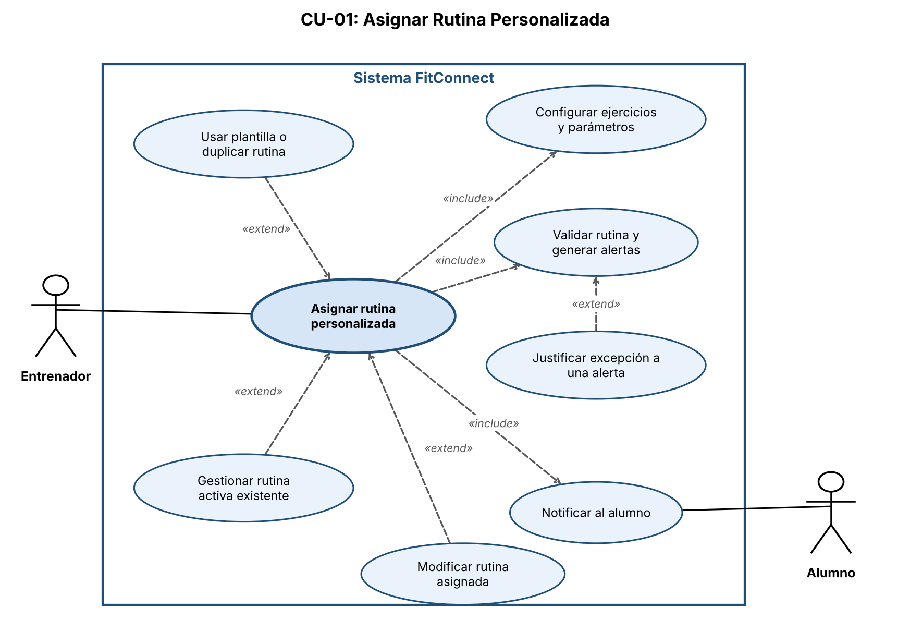

# Punto 3: Casos de Uso (Unidad 5)

Proyecto FitConnect, segunda etapa. Tres casos de uso sobre los requisitos RF-02, RF-05 y RF-07, con su diagrama UML.

| Caso de uso | Requisito | Diagrama |
|---|---|---|
| CU-01 Asignar Rutina Personalizada | RF-02 | [CU-01](diagramas/CU-01_diagrama.png) |
| CU-02 Reservar Sesión con Entrenador | RF-05 | [CU-02](diagramas/CU-02_diagrama.png) |
| CU-03 Contratar Suscripción Premium | RF-07 | [CU-03](diagramas/CU-03_diagrama.png) |

También está el documento completo en [Word](Punto3_Casos_de_Uso_FitConnect.docx) y [PDF](Punto3_Casos_de_Uso_FitConnect.pdf).

---

## CU-01: Asignar Rutina Personalizada

**Requisito funcional asociado:** RF-02: Creación y asignación de rutinas personalizadas.  
**Actor principal:** Entrenador.  
**Actor secundario:** Alumno (recibe la notificación y revisa los cambios).  

**Precondiciones**

1. El Entrenador inició sesión en la aplicación móvil con el rol "Entrenador" activo.
2. El Alumno seleccionado está vinculado a la cuenta del Entrenador y tiene un nivel inicial registrado (principiante, intermedio o avanzado, autodeclarado o verificado con una evaluación breve) o marcado como pendiente.
3. El catálogo de ejercicios y las plantillas están disponibles, con la información necesaria para evaluar las reglas de planificación (grupo muscular y prerrequisitos de cada ejercicio).

**Flujo básico (happy path)**

1. El Entrenador ingresa al panel de alumnos y selecciona al Alumno.
2. El sistema muestra el perfil del alumno: objetivos físicos, nivel inicial (si está pendiente, se destaca) e historial de entrenamiento y rutinas.
3. El Entrenador selecciona la opción "Asignar rutina".
4. El sistema ofrece crear una rutina desde cero, usar una plantilla o duplicar una rutina previa.
5. El Entrenador elige la modalidad y arma la rutina: selecciona ejercicios del catálogo, los ordena y define series, repeticiones, descanso y días de la semana. Si el nivel del alumno está pendiente, el sistema sugiere priorizar ejercicios introductorios.
6. El Entrenador define la duración del programa (en semanas) y, si corresponde, las progresiones de carga.
7. El Entrenador revisa el resumen de la rutina y presiona "Confirmar y asignar".
8. El sistema valida que la rutina esté completa (todos los ejercicios con series, repeticiones, descanso y días definidos).
9. El sistema evalúa las reglas de planificación: al menos 48 horas entre sesiones que trabajan el mismo grupo muscular, aumento de carga semanal de hasta 15 % y prerrequisitos de los ejercicios según el nivel registrado del alumno. Si no detecta problemas, continúa.
10. El sistema verifica si el alumno ya tiene una rutina activa. Si no la tiene, continúa.
11. El sistema registra la rutina asociada al alumno en estado "Activa".
12. El sistema muestra una confirmación al Entrenador.
13. El sistema notifica al Alumno (según sus preferencias de notificación), que puede ver la rutina desde su perfil.

**Flujos alternativos y excepciones**

**A1: Alertas de planificación (Paso 9)**

1. El sistema muestra las alertas (regla incumplida y ejercicio o semana afectados; por ejemplo, un ejercicio por encima del nivel registrado o sin prerrequisitos definidos) como advertencias preventivas. No bloquean la asignación ni reemplazan el criterio del Entrenador.
2. El Entrenador elige ajustar la rutina (el flujo retoma en el paso 5) o mantenerla tal como está.
3. Si la mantiene, el sistema le pide una justificación por cada alerta y la registra junto con la rutina. El flujo retoma en el paso 10.

**A2: El alumno ya tiene una rutina activa (Paso 10)**

1. El sistema muestra la rutina vigente y avisa al Entrenador, sin reemplazarla automáticamente.
2. El sistema ofrece dos opciones: (A) Reemplazar: el Entrenador confirma, el sistema archiva la rutina vigente conservando su historial y activa la nueva. (B) Programar: el Entrenador elige una fecha de inicio posterior; el sistema guarda la nueva rutina como "Programada" y la activa automáticamente en esa fecha, archivando la vigente en ese momento.
3. El Entrenador elige una opción, el sistema registra la rutina y el flujo retoma en el paso 12.

**A3: Modificación de una rutina ya asignada**

1. El Entrenador abre la rutina desde el perfil del Alumno, selecciona "Editar" y modifica ejercicios, series, repeticiones, descansos u observaciones, indicando desde cuándo aplica el cambio.
2. El sistema valida la rutina (pasos 8 y 9, con las mismas alertas y justificaciones).
3. El sistema guarda una nueva versión, conservando las versiones anteriores y lo que el Alumno ya completó.
4. El sistema notifica al Alumno con el detalle de los cambios (ejercicios agregados, quitados o reemplazados; cambios de series, repeticiones, descansos y observaciones) y desde cuándo se aplican.
5. Si el cambio afecta su próxima sesión, la app se lo avisa y le permite revisar la versión actualizada antes de entrenar.

**E1: Rutina incompleta (Paso 8)**

1. El sistema detecta ejercicios con datos faltantes y no permite la asignación.
2. El sistema marca los campos pendientes; el Entrenador los completa y el flujo retoma en el paso 7.

**Postcondiciones**

- La rutina queda registrada y vinculada al Alumno, en estado "Activa" o "Programada".
- Las justificaciones del Entrenador ante alertas quedan registradas junto con la rutina.
- El Entrenador recibió la confirmación y el Alumno fue notificado y puede visualizar la rutina desde su perfil.
- Las versiones anteriores de la rutina y el historial de entrenamiento se conservan.

**Diagrama UML del caso de uso**

---

## CU-02: Reservar Sesión con Entrenador

**Requisito funcional asociado:** RF-05: Reserva de sesiones con entrenadores.  
**Actor principal:** Usuario.  
**Actores secundarios:** Entrenador, Pasarela de Pagos externa.  

**Precondiciones**

1. El Usuario está autenticado en la aplicación móvil.
2. El Entrenador seleccionado tiene su perfil público activo y su agenda de horarios configurada.

**Flujo básico (happy path)**

1. El Usuario ingresa a la sección "Marketplace de Trainers" y aplica filtros de búsqueda (especialidad, tarifa, modalidad, disponibilidad).
2. El sistema muestra la lista de entrenadores que coinciden con los criterios.
3. El Usuario selecciona el perfil de un Entrenador.
4. El sistema muestra especialidades, valoraciones de la comunidad, el precio por sesión fijado por el entrenador y sus horarios disponibles.
5. El Usuario selecciona una fecha y un horario disponible.
6. El sistema muestra el resumen de la reserva con el precio publicado por el entrenador (que es el total a pagar) y la política de cancelación (sin penalidad hasta 24 horas antes del horario pactado), y solicita su aceptación explícita.
7. El Usuario marca la casilla de aceptación y presiona "Proceder al pago".
8. El sistema registra la versión y fecha de la aceptación, valida la disponibilidad del horario y lo retiene durante 10 minutos, controlados por el servidor, y muestra el tiempo restante (el temporizador de la app es solo informativo).
9. El sistema redirige a la Pasarela de Pagos externa.
10. La Pasarela autoriza el pago y lo informa al backend.
11. El backend confirma que la retención sigue vigente, captura el cobro, registra la reserva en estado "Pendiente de aceptación" (el horario sigue reservado mientras el Entrenador responde) y le notifica la solicitud, con el monto que recibirá.
12. El Entrenador revisa la solicitud y la acepta dentro de las 12 horas posteriores a la aprobación del pago.
13. El sistema pasa la reserva a "Confirmada" y bloquea definitivamente el horario en la agenda del entrenador.
14. El sistema envía una notificación push con los detalles al Usuario y al Entrenador, y un correo al Usuario con la confirmación y el comprobante.

**Flujos alternativos y excepciones**

**A1: Cancelación de la reserva por el Usuario (post-reserva)**

1. El Usuario accede a "Mis reservas" y selecciona "Cancelar sesión".
2. El sistema verifica el tiempo restante para el inicio de la sesión.
3. Si la reserva está pendiente de aceptación: el sistema permite cancelar sin penalidad y devuelve el 100 %.
4. Si faltan 24 horas o más: el sistema muestra el reembolso que corresponde (100 %, sin penalidad adicional de la plataforma) y el plazo estimado de acreditación, y pide confirmar. Al confirmar, cancela la reserva, libera el horario, solicita el reembolso a la Pasarela y notifica por push al Usuario y al Entrenador.
5. Si faltan menos de 24 horas: el sistema informa que corresponde un reembolso del 50 % (el otro 50 % se reconoce al Entrenador por el horario reservado) y el plazo estimado de acreditación, y pide confirmar. Si el horario vuelve a ocuparse, el reembolso pasa a ser total. También ofrece contactar al Entrenador o a soporte.

**A2: El Entrenador rechaza la solicitud o no responde (Paso 12)**

1. El Entrenador rechaza la solicitud o pasan 12 horas desde la aprobación del pago sin respuesta.
2. El sistema cancela la solicitud, libera el horario y devuelve el 100 % al Usuario, sin retener comisión.
3. El sistema notifica por push al Usuario el resultado y la devolución.

**A3: Ausencia del entrenador o fuerza mayor (post-reserva)**

1. El Usuario informa que el Entrenador no se presentó, o se informa una situación de fuerza mayor que impide la sesión.
2. Ausencia sin causa válida: el sistema devuelve el 100 % al Usuario, sin comisión de FitConnect.
3. Fuerza mayor: el sistema ofrece primero reprogramar la sesión sin cargo, si ambas partes están de acuerdo. Si no es posible o el Usuario no quiere reprogramar, devuelve el 100 %, sin penalidad.
4. El sistema notifica el resultado al Usuario y al Entrenador.

**E1: Horario no disponible (Paso 8)**

1. Al validar, el sistema detecta que otro usuario ya reservó ese horario.
2. El sistema informa "El horario seleccionado ya no está disponible" sin realizar ningún cobro, actualiza la agenda y retorna al paso 5.

**E2: Vence la retención del horario (Pasos 9-10)**

1. Pasan los 10 minutos sin que el pago se confirme.
2. El sistema libera automáticamente el horario, informa al Usuario y retorna al paso 5. Si el pago se aprueba después del vencimiento y otro usuario ya reservó el horario, no se desplaza esa reserva: el sistema cancela la autorización (o inicia el reembolso, si el cobro ya se capturó) y avisa al Usuario.

**E3: Pago rechazado (Paso 10)**

1. La Pasarela rechaza el pago y el sistema informa que la reserva no fue confirmada.
2. Mientras dure la retención, el sistema ofrece reintentar o cambiar el medio de pago (mismo comportamiento que CU-03, A1) y el flujo retoma en el paso 9.

**E4: Cobro aprobado pero reserva no registrada (Paso 11)**

1. La Pasarela aprueba el cobro, pero falla el registro de la reserva en FitConnect (la base de datos y la pasarela no se actualizan de forma atómica).
2. El sistema reintenta el registro y concilia el estado con la Pasarela; si no puede completarlo, anula o devuelve el cobro y/o genera un ticket de reconciliación. Las notificaciones de pago repetidas o tardías se procesan sin duplicar el cobro.
3. El sistema notifica al Usuario: "Tu reserva no pudo confirmarse. Si se realizó un cobro, será devuelto".

**Postcondiciones**

- La sesión queda registrada en estado "Confirmada" y el horario queda bloqueado para otros usuarios.
- Se guardan la versión y fecha de la política de cancelación aceptada.
- Se registra el cobro y la comisión de FitConnect: 20 % fijo en el MVP, descontado de lo que cobra el entrenador (sobre un precio publicado de $10.000, el usuario paga $10.000 y el entrenador recibe $8.000, antes de impuestos y otros cargos).
- El Usuario recibe push y correo con la confirmación y el comprobante; el Entrenador recibe push.
- Si la reserva se cancela a tiempo, el horario vuelve a estar disponible.

**Aclaración:** los porcentajes de reembolso por cancelación (100 % con 24 horas o más de anticipación, 50 % con menos) y el tratamiento de la ausencia del entrenador o de fuerza mayor son criterios propuestos por Mara, pendientes de aprobación por asesoría legal y Finanzas.

**Diagrama UML del caso de uso**

---

## CU-03: Contratar Suscripción Premium

**Requisito funcional asociado:** RF-07: Gestión de suscripción y pagos.  
**Actor principal:** Usuario (plan Gratuito).  
**Actor secundario:** Pasarela de Pagos externa (Stripe).  

**Precondiciones**

1. El Usuario inició sesión en la aplicación móvil con una cuenta en plan "Gratuito".
2. La integración con la Pasarela de Pagos se encuentra operativa.

**Flujo básico (happy path)**

1. El Usuario intenta acceder a una funcionalidad exclusiva (programas avanzados, análisis avanzado de progreso o almacenamiento ilimitado de fotos) o presiona "Obtener Premium" desde su perfil.
2. El sistema muestra la pantalla de FitConnect Premium con la comparativa Gratuito vs. Premium (acceso completo a programas, análisis avanzado y almacenamiento ilimitado) y los planes disponibles con su precio y beneficios.
3. El Usuario selecciona la modalidad de suscripción (mensual o anual).
4. El sistema presenta el resumen del pedido: monto, renovación automática (que puede cancelarse en cualquier momento desde la cuenta) y Términos y Condiciones comerciales.
5. El Usuario marca la casilla de aceptación de los términos comerciales y presiona "Confirmar y pagar".
6. El sistema guarda la versión y fecha de la aceptación y abre el formulario seguro de la Pasarela de Pagos.
7. El Usuario ingresa los datos de su tarjeta en el formulario de la Pasarela y confirma la operación.
8. La Pasarela procesa la transacción y envía la confirmación de cobro aprobado (webhook) al backend de FitConnect.
9. El backend valida la transacción, actualiza la cuenta a "Premium" y habilita programas avanzados, análisis avanzado y almacenamiento ilimitado.
10. El sistema envía una notificación de bienvenida y emite el comprobante de pago por correo electrónico.

**Flujos alternativos y excepciones**

**A1: Pago rechazado por la Pasarela (Paso 8)**

1. La Pasarela rechaza la transacción (fondos insuficientes, datos erróneos o tarjeta vencida).
2. El sistema informa: "El pago no pudo ser procesado. Tu suscripción no ha sido activada".
3. El sistema conserva el plan elegido y ofrece "Reintentar pago" o "Cambiar medio de pago".
4. El Usuario ingresa datos válidos y el flujo retoma en el paso 7.

**E1: Pérdida de conexión tras el pago (Pasos 8-9)**

1. La Pasarela aprueba el cobro, pero el teléfono del Usuario pierde la conexión.
2. El backend recibe la confirmación por webhook (servidor a servidor), valida el pago y activa Premium.
3. Al restablecerse la conexión, la app sincroniza el perfil con el plan Premium, sin reintentos ni cobros duplicados.

**Postcondiciones**

- La cuenta del Usuario queda en estado "Premium".
- Se habilitan los programas avanzados, el análisis avanzado y el almacenamiento ilimitado de fotos.
- El Usuario recibe el comprobante por correo.
- FitConnect no almacena los datos completos de la tarjeta; solo guarda el identificador de la transacción para auditoría y cobros recurrentes.

**Aclaración:** la regla de cancelación de la renovación automática es una propuesta de Mara, pendiente de aprobación. Los precios y períodos de los planes todavía no están definidos.

**Diagrama UML del caso de uso**

---

### Ajustes en los requisitos funcionales (para que coincidan con los casos de uso)

**RF-05: criterios de aceptación a agregar o ajustar**

- El pago de la sesión debe realizarse a través de la pasarela de pagos externa; el precio publicado por el entrenador es el total que paga el usuario.
- El horario seleccionado se retiene durante 10 minutos mientras se completa el pago y se libera automáticamente si no se confirma.
- La reserva se confirma cuando el pago se aprueba y el entrenador la acepta dentro de las 12 horas siguientes; si rechaza o no responde, se devuelve el 100 %.
- Ajuste del criterio de cancelación: el usuario puede cancelar sin penalidad hasta 24 horas antes del horario pactado; con menos anticipación se aplica la política de cancelación tardía (propuesta, pendiente de aprobación).

**RF-02: criterios de aceptación recomendados**

- El sistema debe advertir posibles problemas de planificación (descanso, aumento de carga, ejercicios por encima del nivel del alumno o sin prerrequisitos definidos) sin bloquear la asignación, y pedir una justificación si el entrenador decide mantenerlos.
- Al modificar una rutina asignada, el sistema conserva las versiones y el historial, y el alumno puede ver qué cambió y desde cuándo aplica.
